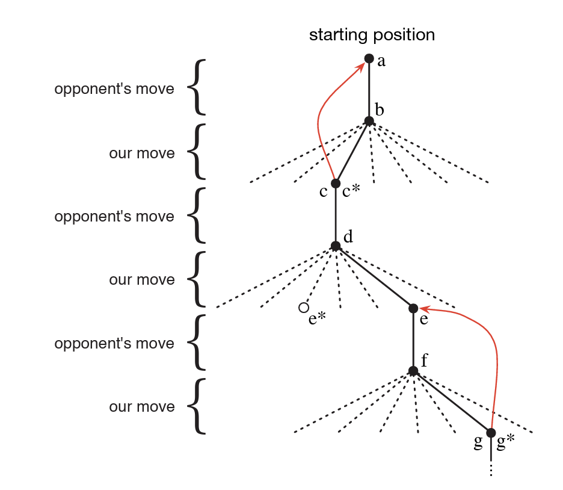

# Introduction

The idea that we learn by interacting with our environment is probably the first to occur to us when we think about the nature of learning. When an infant plays, waves its arms, or looks about, it has no explicit teacher, but it does have a direct sensorimotor connection to its environment. Exercising this connection produces a wealth of information about cause and e↵ect, about the consequences of actions, and about what to do in order to achieve goals.

Reinforcement learning is learning what to do (how to map situations to actions) so as to maximize a numerical reward signal. The learner (also known as the **agent**) is not told which actions to take, but instead must discover which actions yield the most reward by trying them. In the most interesting and challenging cases, actions may affect not only the immediate reward but also the next situation and, through that, all subsequent rewards. These two characteristics **(trial-and-error search and delayed reward)** are the two most important distinguishing features of reinforcement learning.

The terms supervised learning and unsupervised learning would seem to exhaustively classify machine learning paradigms, but they do not. Although one might be tempted to think of reinforcement learning as a kind of unsupervised learning because it does not rely on examples of correct behavior, reinforcement learning is trying to maximize a reward signal instead of trying to find hidden structure. Uncovering structure in an agent’s experience can certainly be useful in reinforcement learning, but by itself does not address the reinforcement learning problem of maximizing a reward signal. We therefore consider reinforcement learning to be a third machine learning paradigm, alongside supervised learning and unsupervised learning.

One of the challenges that arise in reinforcement learning, and not in other kinds of learning, is the trade-off between exploration and exploitation. To obtain a lot of reward, a reinforcement learning agent must prefer actions that it has tried in the past and found to be e↵ective in producing reward. But to discover such actions, it has to try actions that it has not selected before. The agent has to exploit what it has already experienced in order to obtain reward, but it also has to explore in order to make better action selections in the future. The dilemma is that neither exploration nor exploitation can be pursued exclusively without failing at the task.

Another key feature of reinforcement learning is that it explicitly considers the **whole** problem of a goal-directed agent interacting with an uncertain environment. This is in contrast to many approaches that consider subproblems without addressing how they might fit into a larger picture. All reinforcement learning agents have explicit goals, can sense aspects of their environments, and can choose actions to influence their environments. Moreover, it is usually assumed from the beginning that the agent has to operate despite significant uncertainty about the environment it faces. By a complete, interactive, goal-seeking agent we do not always mean something like a complete organism or robot. These are clearly examples, but a complete, interactive, goal-seeking agent can also be a component of a larger behaving system. In this case, the agent directly interacts with the rest of the larger system and indirectly interacts with the larger system’s environment. A simple example is an agent that monitors the charge level of robot’s battery and sends commands to the robot’s control architecture. This agent’s environment is the rest of the robot together with the robot’s environment.

Let's look at some examples.

1. A master chess player makes a move. The choice is informed both by planning (anticipating possible replies and counterreplies) and by immediate, intuitive judgments of the desirability of particular positions and moves.

2. Agazelle calf struggles to its feet minutes after being born. Half an hour later it is running at 20 miles per hour.

3. A mobile robot decides whether it should enter a new room in search of more trash to collect or start trying to find its way back to its battery recharging station. It makes its decision based on the current charge level of its battery and how quickly and easily it has been able to find the recharger in the past.

These examples share features that are so basic that they are easy to overlook. All involve interaction between an active decision-making agent and its environment, within which the agent seeks to achieve a goal despite uncertainty about its environment. The agent’s actions are permitted to affect the future state of the environment (e.g., the next chess position, the robot’s next location and the future charge level of its battery), thereby affecting the actions and opportunities available to the agent at later times. Correct choice requires taking into account indirect, delayed consequences of actions, and thus may require foresight or planning. At the same time, in all of these examples the effects of actions cannot be fully predicted; thus the agent must monitor its environment frequently and react appropriately. All these examples involve goals that are explicit in the sense that the agent can judge progress toward its goal based on what it can sense directly. The chess player knows whether or not he wins, the gazelle calf knows when it falls, and the mobile robot knows when its batteries run down.

In all of these examples the agent can use its experience to improve its performance over time. The chess player refines the intuition he uses to evaluate positions, thereby improving his play; the gazelle calf improves the efficiency with which it can run.

The knowledge the agent brings to the task (either from previous experience with related tasks or built into it by design or evolution) influences what is useful or easy to learn, but interaction with the environment is essential for adjusting behavior to exploit the task.

## Elements of Reinforcement Learning

Beyond the agent and the environment, one can identify four main subelements of a reinforcement learning system: a **policy**, a **reward signal**, a **value function**, and, optionally, a **model of the environment**.

A **policy** defines the learning agent’s way of behaving at a given time. Roughly speaking, a policy is a mapping from perceived states of the environment to actions to be taken when in those states, $\pi: \mathcal{S} \to \mathcal{A}$, where $\mathcal{S}$ is the set of states and $\mathcal{A}$ the set of actions. In some cases the policy may be a simple function or lookup table, whereas in others it may involve extensive computation such as a search process. The policy is the core of a reinforcement learning agent in the sense that it alone is sufficient to determine behavior. In general, policies may be stochastic, specifying probabilities for each action: $\pi(a \mid s)$ is the probability of taking action $a$ in state $s$, with $\sum_{a} \pi(a \mid s) = 1$.

On each time step, the environment sends to the reinforcement learning agent a single number called the **reward**, $R_t \in \mathbb{R}$. The agent’s sole objective is to maximize the total reward it receives over the long run, $R_1 + R_2 + R_3 + \cdots = \sum_{t} R_t$. The reward signal thus defines what are the good and bad events for the agent. In a biological system, we might think of rewards as analogous to the experiences of pleasure or pain. The reward signal is the primary basis for altering the policy; if an action selected by the policy is followed by low reward, then the policy may be changed to select some other action in that situation in the future. In general, reward signals may be stochastic functions of the state of the environment and the actions taken, i.e. $R_{t+1}$ is drawn from a distribution that depends on $S_t$ and $A_t$.

Whereas the reward signal indicates what is good in an immediate sense, a **value function** specifies what is good in the long run. Roughly speaking, the **value of a state is the total amount of reward an agent can expect to accumulate over the future, starting from that state**:

$$
v(s) = \mathbb{E}\left[ R_{t+1} + R_{t+2} + R_{t+3} + \cdots \mid S_t = s \right]
$$

Whereas rewards determine the immediate, intrinsic desirability of environmental states, values indicate the long-term desirability of states after taking into account the states that are likely to follow and the rewards available in those states. For example, a state might always yield a low immediate reward $R_{t+1}$ but still have a high value $v(s)$ because it is regularly followed by other states that yield high rewards. Or the reverse could be true.

Rewards are in a sense primary, whereas values, as predictions of rewards, are secondary. Without rewards there could be no values, and the only purpose of estimating values is to achieve more reward. Nevertheless, it is values with which we are most concerned when making and evaluating decisions. Action choices are made based on value judgments. We seek actions that bring about states of highest value, not highest reward, because these actions obtain the greatest amount of reward for us over the long run. Unfortunately, it is much harder to determine values than it is to determine rewards. Rewards are basically given directly by the environment, but values must be estimated and re-estimated from the sequences of observations an agent makes over its entire lifetime. In fact, the most important component of almost all reinforcement learning algorithms we consider is a method for efficiently estimating values.

The fourth and final element of some reinforcement learning systems is a **model of the environment**. This is something that mimics the behavior of the environment, or more generally, that allows inferences to be made about how the environment will behave. For example, given a state $s$ and action $a$, the model might predict the resultant next state $s'$ and next reward $r$, i.e. it estimates $p(s', r \mid s, a)$. Models are used for **planning, by which we mean any way of deciding on a course of action by considering possible future situations before they are actually experienced**. Methods for solving reinforcement learning problems that use models and planning are called **model-based methods**, as opposed to simpler **model-free methods** that are explicitly trial-and-error learners (viewed as almost the opposite of planning).

Reinforcement learning relies heavily on the concept of **state** as input to the policy and value function, and as both input to and output from the model. Informally, we can think of the state as a signal conveying to the agent some sense of “how the environment is” at a particular time. The formal definition of state as we use it here is given by the framework of Markov decision processes that we discuss later. Think of the state as whatever information is available to the agent about its environment.

## Case study: Tic-Tac-Toe

Because a skilled player can play so as never to lose, let us assume that we are playing against an imperfect player, one whose play is sometimes incorrect and allows us to win. For the moment, in fact, let us consider draws and losses to be equally bad for us. How might we construct a player that will find the imperfections in its opponent’s play and learn to maximize its chances of winning? Although this is a simple problem, it cannot readily be solved in a satisfactory way through classical techniques. For example, the classical “minimax” solution from game theory is not correct here because it assumes a particular way of playing by the opponent. **Minimax assumes the opponent always plays its best possible reply.** It scores every position by the worst outcome the opponent could force, so it never takes a risk, even one that would pay off against this particular opponent. Two things follow:

1. **It can't tell moves apart.** Tic-tac-toe is a draw under perfect play, and here we count draws as losses. So minimax rates almost every position as "can't win" and has no reason to prefer one move over another.
2. **It ignores the opponent's mistakes.** Say we're in a position with two options:
    - **Move A** sets a trap. A perfect opponent can find the one reply that beats us, but our imperfect opponent misses it 9 times out of 10 ($P(\text{miss}) = 0.9$), and then we win.
    - **Move B** is safe, but it can only ever lead to a draw.

    Minimax picks B, or at best treats A and B as equally good, because A has a line where we lose. Against this opponent, though, $P(\text{win} \mid A) = 0.9$ while $P(\text{win} \mid B) = 0$.

**What we actually want is a player that learns how *this* opponent plays and takes advantage of its weaknesses.** Minimax can't do that, because it never looks at how the opponent really behaves.

Classical optimization methods for sequential decision problems, can compute an optimal solution for any opponent, but require as input a complete specification of that opponent, including the probabilities with which the opponent makes each move in each board state. Let us assume that this information is not available a priori for this problem, as it is not for the vast majority of problems of practical interest.

Here is how the tic-tac-toe problem would be approached with a method making use of a value function. First we would set up a table of numbers, one for each possible state of the game. Each number $V(s)$ will be the latest estimate of the probability of our winning from state $s$, i.e. $V(s) \approx P(\text{win} \mid s)$. We treat this estimate as the state’s value, and the whole table is the learned value function. State $A$ has higher value than state $B$, or is considered “better” than state $B$, if $V(A) > V(B)$, i.e. the current estimate of the probability of our winning from $A$ is higher than it is from $B$. Assuming we always play Xs, then for all states $s$ with three Xs in a row the probability of winning is $V(s) = 1$, because we have already won. Similarly, for all states with three Os in a row, or that are filled up, the correct probability is $V(s) = 0$, as we cannot win from them. We set the initial values of all the other states to $V(s) = 0.5$, representing a guess that we have a 50% chance of winning.

We then play many games against the opponent. To select our moves we examine the states that would result from each of our possible moves (one for each blank space on the board) and look up their current values in the table. Most of the time we move greedily, selecting the move that leads to the state with greatest value, $s^* = \arg\max_{s'} V(s')$ over the states $s'$ reachable in one move, that is, with the highest estimated probability of winning. Occasionally, however, we select randomly from among the other moves instead. These are called exploratory moves because they cause us to experience states that we might otherwise never see.

While we are playing, we change the values of the states in which we find ourselves during the game. We attempt to make them more accurate estimates of the probabilities of winning. To do this, we “back up” the value of the state after each greedy move to the state before the move, as suggested by the arrows in the figure above. More precisely, the current value of the earlier state is updated to be closer to the value of the later state. This can be done by moving the earlier state’s value a fraction of the way toward the value of the later state. If we let $S_t$ denote the state before the greedy move, and $S_{t+1}$ the state after that move, then the update to the estimated value of $S_t$, denoted $V(S_t)$, can be written as:

$$
V(S_t) \leftarrow V(S_t) + \alpha \left[ V(S_{t+1}) - V(S_t) \right]
$$

where $\alpha \in (0, 1]$ is a small positive fraction called the step-size parameter, which influences the rate of learning. This update rule is an example of a temporal-difference learning method, so called because its changes are based on a difference, $V(S_{t+1}) - V(S_t)$, between estimates at two successive times.

The method described above performs quite well on this task. For example, if the step-size parameter is reduced properly over time, then this method converges, for any fixed opponent, to the true probabilities of winning from each state given optimal play by our player. Furthermore, the moves then taken (except on exploratory moves) are in fact the optimal moves against this (imperfect) opponent. In other words, the method converges to an optimal policy for playing the game against this opponent.

This simple example illustrates some of the key features of reinforcement learning methods. First, there is the emphasis on learning while interacting with an environment, in this case with an opponent player. Second, there is a clear goal, and correct behavior requires planning or foresight that takes into account delayed effects of one’s choices. For example, the simple reinforcement learning player would learn to set up multi-move traps for a shortsighted opponent. It is a striking feature of the reinforcement learning solution that it can achieve the effects of planning and lookahead without using a model of the opponent and without conducting an explicit search over possible sequences of future states and actions. 

While this example illustrates some of the key features of reinforcement learning, it is so simple that it might give the impression that reinforcement learning is more limited than it really is. Although tic-tac-toe is a two-person game, reinforcement learning also applies in the case in which there is no external adversary, that is, in the case of a “game against nature.” Reinforcement learning also is not restricted to problems in which behavior breaks down into separate episodes, like the separate games of tic-tac-toe, with reward only at the end of each episode. It is just as applicable when behavior continues indefinitely and when rewards of various magnitudes can be received at any time. Reinforcement learning is also applicable to problems that do not even break down into discrete time steps like the plays of tic-tac-toe. The general principles apply to continuous-time problems as well, although the theory gets more complicated.

## Exercises