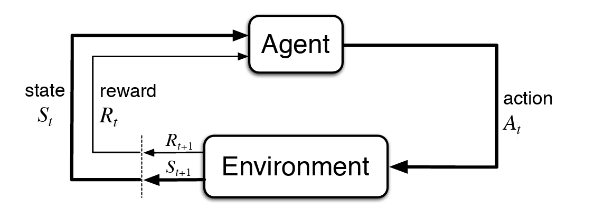
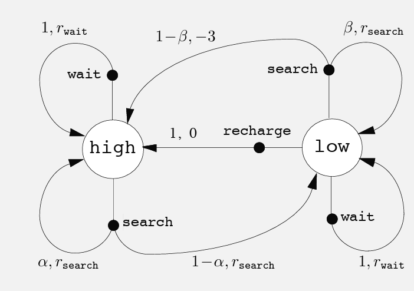

# Finite Markov Decision Processes

## A Primer: Conditional Probability and Conditional Expectation

It is worth getting comfortable with two ideas: **conditional probability** and **conditional expectation**. You have actually met the second one already. See the definition of an action's value, $q_*(a) = \mathbb{E}[R_t \mid A_t = a]$, in [A k-armed Bandit Problem](multi_armed_bandits.md#a-k-armed-bandit-problem).

The math pages ([Probability](../../math/probability/probability_and_counting.md) section of the math pages) write these as $P(A \mid B)$ and $E[X \mid Y]$; here we follow the reinforcement learning convention $\Pr\{A \mid B\}$ and $\mathbb{E}[X \mid Y]$. They mean the same thing.

### Conditional probability: shrink the world, then re-scale

The whole idea fits in one sentence: **to condition on $B$, throw away every outcome where $B$ did not happen, and re-scale what is left so it adds up to $1$.**

Suppose a cleaning robot logs its battery level (high or low) on $100$ consecutive steps, and also what its battery level was on the step after. The counts are:

| | Next: high | Next: low | Total |
|---|---|---|---|
| **Now: high** | $48$ | $12$ | $60$ |
| **Now: low** | $10$ | $30$ | $40$ |
| **Total** | $58$ | $42$ | $100$ |

*Without any condition*, the robot's battery is low next step on $42$ of the $100$ steps:

$$
\Pr\{\text{next low}\} = \frac{42}{100} = 0.42.
$$

*Given that the battery is high now*, we keep only the first row, $60$ steps, and ignore the rest. Of those $60$, the next battery was low on $12$:

$$
\Pr\{\text{next low} \mid \text{now high}\} = \frac{12}{60} = 0.2.
$$

Similarly, $\Pr\{\text{next low} \mid \text{now low}\} = \frac{30}{40} = 0.75$. Knowing the current battery level changes the odds a lot: from $0.42$ overall, to $0.2$ or $0.75$ depending on what we know.

Dividing the counts by $100$ turns this into the general definition. "Keep only the row" is the intersection $A \cap B$, and "re-scale" is dividing by $\Pr\{B\}$:

$$
\Pr\{A \mid B\} = \frac{\Pr\{A \cap B\}}{\Pr\{B\}}.
$$

Here $A$ is "next low" and $B$ is "now high". The intersection $\text{next low} \cap \text{now high}$ means both happened, so it is the single cell where the row "now high" meets the column "next low": $12$ of the $100$ steps. The condition "now high" is the whole first row: $60$ of the $100$ steps. So

$$
\Pr\{\text{next low} \mid \text{now high}\} = \frac{\Pr\{\text{next low} \cap \text{now high}\}}{\Pr\{\text{now high}\}} = \frac{12/100}{60/100} = \frac{0.12}{0.60} = 0.2,
$$

the same answer as counting within the row directly, $\frac{12}{60} = 0.2$.

Three facts follow:

1. **Given a condition, the probabilities of all outcomes add up to $1$.** $\Pr\{\text{next high} \mid \text{now high}\} + \Pr\{\text{next low} \mid \text{now high}\} = 0.8 + 0.2 = 1$. Each row of the table, re-scaled, is a full probability distribution of its own, called a **conditional distribution**.
2. **Law of total probability: the overall probability is a weighted average of the conditional ones**, weighted by how likely each condition is:

    $$
    \Pr\{\text{next low}\} = \underbrace{0.2}_{\Pr\{\text{low} \mid \text{high}\}} \cdot \underbrace{0.6}_{\Pr\{\text{high}\}} + \underbrace{0.75}_{\Pr\{\text{low} \mid \text{low}\}} \cdot \underbrace{0.4}_{\Pr\{\text{low}\}} = 0.12 + 0.30 = 0.42. \;\checkmark
    $$

3. **You can condition on several things at once.** $\Pr\{A \mid B, C\}$ means: keep only the outcomes where *both* $B$ and $C$ happened, then re-scale.

The **Markov property** is a statement about conditioning too. Once you know the current state and action, also knowing the earlier history does not change the probabilities,

$$
\Pr\{S_{t+1} = s' \mid S_t, A_t, S_{t-1}, A_{t-1}, \dots, S_0\} = \Pr\{S_{t+1} = s' \mid S_t, A_t\}.
$$

In other words, the future is **conditionally independent** of the past, given the present.

### Conditional expectation: the average inside the smaller world

Conditional expectation uses the same move. **To compute $\mathbb{E}[X \mid B]$, shrink the world to the outcomes where $B$ happened, and take the ordinary average of $X$ there:**

$$
\mathbb{E}[X \mid B] = \sum_x x \cdot \Pr\{X = x \mid B\}.
$$

It is the plain expectation $\mathbb{E}[X] = \sum_x x \cdot \Pr\{X = x\}$, with every probability replaced by its conditional version.

Back to the robot. Suppose that on each step it also earns a reward $R$ that depends on its current battery:

| Now | Possible rewards | $\mathbb{E}[R \mid \text{now}]$ |
|---|---|---|
| high | $4$ or $2$, each with probability $\tfrac{1}{2}$ | $\tfrac{1}{2} \cdot 4 + \tfrac{1}{2} \cdot 2 = 3$ |
| low | $1$ with probability $\tfrac{3}{4}$, or $-3$ (it runs flat and must be rescued) with probability $\tfrac{1}{4}$ | $\tfrac{3}{4} \cdot 1 + \tfrac{1}{4} \cdot (-3) = 0$ |

So $\mathbb{E}[R \mid \text{now high}] = 3$ and $\mathbb{E}[R \mid \text{now low}] = 0$. Each conditional expectation is just **a number: the average reward in that situation**. That is exactly what a value is in reinforcement learning, and it is how $q_*(a)$ was defined in the [bandit chapter](multi_armed_bandits.md#a-k-armed-bandit-problem).

When the condition is a random variable rather than a fixed event, as in $\mathbb{E}[R \mid S]$ with $S$ the current battery level, the result is a *function* of $S$: it equals $3$ when $S$ is high and $0$ when $S$ is low. Because $S$ is random, $\mathbb{E}[R \mid S]$ is itself a random variable.

Two properties to be thororugh with:

1. **Law of total expectation (Adam's law): the overall average is a weighted average of the conditional averages.**

    $$
    \mathbb{E}[R] = \sum_s \mathbb{E}[R \mid S = s] \cdot \Pr\{S = s\} = \underbrace{3}_{\text{high}} \cdot 0.6 + \underbrace{0}_{\text{low}} \cdot 0.4 = 1.8.
    $$

    In compact form, $\mathbb{E}\big[ \mathbb{E}[R \mid S] \big] = \mathbb{E}[R]$. As a check, computing directly from the overall reward distribution gives the same answer: $4 \cdot 0.3 + 2 \cdot 0.3 + 1 \cdot 0.3 + (-3) \cdot 0.1 = 1.8$.

2. **Taking out what's known.** Inside $\mathbb{E}[\,\cdot \mid S = s]$, anything that depends only on $s$ is a fixed number and can be pulled outside: $\mathbb{E}[h(S) \, R \mid S = s] = h(s) \, \mathbb{E}[R \mid S = s]$. We used this in the gradient bandit derivation, where $g(A_t)$ came out of $\mathbb{E}[\,\cdot \mid A_t = x]$ as the number $g(x)$.

### Cheat sheet

| Notation | Read as | Meaning |
|---|---|---|
| $\Pr\{A \mid B\}$ | probability of $A$ given $B$ | keep only outcomes where $B$ happened, re-scale, then ask how often $A$ happens |
| $\Pr\{A \mid B, C\}$ | probability of $A$ given $B$ and $C$ | same, keeping only outcomes where both $B$ and $C$ happened |
| $\mathbb{E}[X \mid B]$ | expected value of $X$ given $B$ | the average of $X$ over only the outcomes where $B$ happened (a number) |
| $\mathbb{E}[X \mid Y]$ | expected value of $X$ given $Y$ | the function of $Y$ that gives $\mathbb{E}[X \mid Y = y]$ for each $y$ (a random variable) |
| $\sum_b \Pr\{A \mid B = b\} \Pr\{B = b\}$ | law of total probability | equals $\Pr\{A\}$ |
| $\sum_y \mathbb{E}[X \mid Y = y] \Pr\{Y = y\}$ | law of total expectation | equals $\mathbb{E}[X]$ |

For the full treatment, with proofs and more examples, see the math pages:

- [Conditional Probability](../../math/probability/conditional_probability.md): the [definition](../../math/probability/conditional_probability.md#definition-of-conditional-probability), the [law of total probability](../../math/probability/conditional_probability.md#law-of-total-probability), and [conditional independence](../../math/probability/conditional_probability.md#conditional-independence), which is the idea behind the Markov property.
- [Conditional Distributions](../../math/probability/conditional_distributions.md): a whole distribution given a condition, like each re-scaled row of the table above.
- [Conditional Expectation](../../math/probability/conditional_expectation.md): the [definition](../../math/probability/conditional_expectation.md#definition-of-conditional-expectation) and the [general properties](../../math/probability/conditional_expectation.md#general-properties), including taking out what's known and iterated expectation (Adam's law).
- [Markov Chains](../../math/probability/markov_chains.md): the [transition matrix](../../math/probability/markov_chains.md#transition-matrix), where every row is a conditional distribution of the next state given the current one.

## The Agent–Environment Interface

MDPs are a classical formalization of **sequential decision making**, where actions influence not just immediate rewards, but also subsequent situations, or states, and through those future rewards. Thus MDPs involve **delayed reward** and the need to trade off immediate and delayed reward. Whereas in bandit problems we estimated the value $q_*(a)$ of each action $a$, in MDPs we estimate the value $q_*(s, a)$ of each action $a$ in each state $s$, or we estimate the value $v_*(s)$ of each state given optimal action selections.

| Value | Depends on | Question it answers |
|---|---|---|
| $q_*(a)$ | action $a$ | How good is action $a$? (bandits, where there is only one situation) |
| $q_*(s, a)$ | state $s$ and action $a$ | How good is taking action $a$ in state $s$, and acting optimally afterwards? |
| $v_*(s)$ | state $s$ | How good is being in state $s$, if we act optimally from here on? |

MDPs are meant to be a straightforward framing of the problem of learning from interaction to achieve a goal. The learner and decision maker is called the **agent**. The thing it interacts with, comprising everything outside the agent, is called the **environment**. These interact continually, the agent selecting actions and the environment responding to these actions and presenting new situations to the agent. The environment also gives rise to **rewards**, special numerical values that the agent seeks to maximize over time through its choice of actions.

More specifically, the agent and environment interact at each of a sequence of discrete time steps, $t = 0, 1, 2, 3, \dots$. At each time step $t$, the agent receives some representation of the environment’s **state**, $S_t \in \mathcal{S}$, and on that basis selects an **action**, $A_t \in \mathcal{A}(s)$. One time step later, in part as a consequence of its action, the agent receives a numerical **reward**, $R_{t+1} \in \mathcal{R} \subset \mathbb{R}$, and finds itself in a new state, $S_{t+1}$. The MDP and agent together thereby give rise to a sequence or **trajectory** that begins like this:

$$
S_0, A_0, R_1, S_1, A_1, R_2, S_2, A_2, R_3, \dots
$$

| Symbol | Meaning |
|---|---|
| $\mathcal{S}$ | the set of all possible states |
| $\mathcal{A}(s)$ | the set of actions available in state $s$ (it can differ from state to state) |
| $\mathcal{R} \subset \mathbb{R}$ | the set of possible rewards, a subset of the real numbers |

In a **finite MDP**, the sets of states, actions, and rewards ($\mathcal{S}$, $\mathcal{A}$, and $\mathcal{R}$) all have a finite number of elements. In this case, the random variables $R_t$ and $S_t$ have well defined discrete probability distributions dependent only on the preceding state and action. That is, for particular values of these random variables, $s' \in \mathcal{S}$ and $r \in \mathcal{R}$, there is a probability of those values occurring at time $t$, given particular values of the preceding state and action:

$$
p(s', r \mid s, a) \doteq \Pr\{S_t = s', R_t = r \mid S_{t-1} = s, A_{t-1} = a\},
$$

for all $s', s \in \mathcal{S}$, $r \in \mathcal{R}$, and $a \in \mathcal{A}(s)$. The function $p$ defines the **dynamics** of the MDP. The dot over the equals sign in the equation reminds us that it is a definition (in this case of the function $p$) rather than a fact that follows from previous definitions. The dynamics function

$$
p : \mathcal{S} \times \mathcal{R} \times \mathcal{S} \times \mathcal{A} \to [0, 1]
$$

is an ordinary deterministic function of four arguments.

This is a [conditional probability](#conditional-probability-shrink-the-world-then-re-scale) (keep only the moments when the agent was in state $s$ and took action $a$, and ask how often the next state was $s'$ and the reward was $r$). For each fixed $(s, a)$, the values $p(s', r \mid s, a)$ form a full probability distribution over the possible outcomes $(s', r)$.

$p$ specifies a probability distribution for each choice of $s$ and $a$, that is, that

$$
\sum_{s' \in \mathcal{S}} \sum_{r \in \mathcal{R}} p(s', r \mid s, a) = 1, \qquad \text{for all } s \in \mathcal{S}, \; a \in \mathcal{A}(s).
$$

In words: fix the current state $s$ and action $a$. Every possible outcome is some combination of a next state $s'$ and a reward $r$, and their probabilities, summed over all of these combinations, must add up to $1$. This is the first fact from the primer: given a condition, the probabilities of all outcomes add up to $1$.

In a Markov decision process, the probabilities given by $p$ completely characterize the environment’s dynamics. That is, the probability of each possible value for $S_t$ and $R_t$ depends on the immediately preceding state and action, $S_{t-1}$ and $A_{t-1}$, and, given them, not at all on earlier states and actions:

$$
\Pr\{S_t = s', R_t = r \mid S_{t-1}, A_{t-1}, S_{t-2}, A_{t-2}, \dots, S_0, A_0\} = \Pr\{S_t = s', R_t = r \mid S_{t-1}, A_{t-1}\} = p(s', r \mid S_{t-1}, A_{t-1}).
$$

This is best viewed as a restriction not on the decision process, but on the state. The state must include information about all aspects of the past agent–environment interaction that make a difference for the future. If it does, then the state is said to have the **Markov property**.

For example, the positions of all the pieces on a chess board are a Markov state: how the game reached that position makes no difference to what can happen next.

From the four-argument dynamics function, $p$, one can compute anything else one might want to know about the environment, such as the **state-transition probabilities** (which we denote, with a slight abuse of notation, as a three-argument function $p : \mathcal{S} \times \mathcal{S} \times \mathcal{A} \to [0, 1]$),

$$
p(s' \mid s, a) \doteq \Pr\{S_t = s' \mid S_{t-1} = s, A_{t-1} = a\} = \sum_{r \in \mathcal{R}} p(s', r \mid s, a).
$$

We can also compute the **expected rewards** for state–action pairs as a two-argument function $r : \mathcal{S} \times \mathcal{A} \to \mathbb{R}$:

$$
r(s, a) \doteq \mathbb{E}[R_t \mid S_{t-1} = s, A_{t-1} = a] = \sum_{r \in \mathcal{R}} r \sum_{s' \in \mathcal{S}} p(s', r \mid s, a),
$$

and the expected rewards for state–action–next-state triples as a three-argument function $r : \mathcal{S} \times \mathcal{A} \times \mathcal{S} \to \mathbb{R}$,

$$
r(s, a, s') \doteq \mathbb{E}[R_t \mid S_{t-1} = s, A_{t-1} = a, S_t = s'] = \sum_{r \in \mathcal{R}} r \, \frac{p(s', r \mid s, a)}{p(s' \mid s, a)}.
$$

Both are [conditional expectations](#conditional-expectation-the-average-inside-the-smaller-world): the average reward, over only the moments that match the condition. To see where the formulas come from, start from the definition $\mathbb{E}[R_t \mid \text{condition}] = \sum_r r \cdot \Pr\{R_t = r \mid \text{condition}\}$, and find that conditional probability of the reward.

For $r(s, a)$, the reward $r$ can arrive together with any next state $s'$, so we add up over all of them:

$$
\Pr\{R_t = r \mid S_{t-1} = s, A_{t-1} = a\} = \sum_{s' \in \mathcal{S}} p(s', r \mid s, a).
$$

For $r(s, a, s')$, we also know the next state. By the definition of conditional probability, we divide the probability of "this $s'$ and this $r$" by the probability of "this $s'$":

$$
\Pr\{R_t = r \mid S_{t-1} = s, A_{t-1} = a, S_t = s'\} = \frac{\Pr\{S_t = s', R_t = r \mid S_{t-1} = s, A_{t-1} = a\}}{\Pr\{S_t = s' \mid S_{t-1} = s, A_{t-1} = a\}} = \frac{p(s', r \mid s, a)}{p(s' \mid s, a)}.
$$

Multiplying each by $r$ and summing over $r$ gives the two formulas above.

The MDP framework is abstract and flexible and can be applied to many different problems in many different ways. For example, the time steps $t = 0, 1, 2, \dots$ need not refer to fixed intervals of real time; they can refer to arbitrary successive stages of decision making and acting. The actions $A_t$ can be low-level controls, such as the voltages applied to the motors of a robot arm, or high-level decisions, such as whether or not to have lunch or to go to graduate school. Similarly, the states $S_t$ can take a wide variety of forms. They can be completely determined by low-level sensations, such as direct sensor readings, or they can be more high-level and abstract, such as symbolic descriptions of objects in a room. In general, **actions can be any decisions we want to learn how to make, and states can be anything we can know that might be useful in making them.**

In particular, the boundary between agent and environment is typically not the same as the physical boundary of a robot’s or an animal’s body. Usually, the boundary is drawn closer to the agent than that. For example, the motors and mechanical linkages of a robot and its sensing hardware should usually be considered parts of the environment rather than parts of the agent. Similarly, if we apply the MDP framework to a person or animal, the muscles, skeleton, and sensory organs should be considered part of the environment. Rewards, too, presumably are computed inside the physical bodies of natural and artificial learning systems, but are considered external to the agent.

The general rule we follow is that **anything that cannot be changed arbitrarily by the agent is considered to be outside of it and thus part of its environment**. We do not assume that everything in the environment is unknown to the agent. For example, the agent often knows quite a bit about how its rewards are computed as a function of its actions and the states in which they are taken. But we always consider the reward computation to be external to the agent. **The agent–environment boundary represents the limit of the agent’s absolute control, not of its knowledge.**

The MDP framework is a considerable abstraction of the problem of goal-directed learning from interaction. It proposes that whatever the details of the sensory, memory, and control apparatus, and whatever objective one is trying to achieve, any problem of learning goal-directed behavior can be reduced to three signals passing back and forth between an agent and its environment:

- one signal to represent the choices made by the agent (the **actions**, $A_t$),
- one signal to represent the basis on which the choices are made (the **states**, $S_t$), and
- one signal to define the agent’s goal (the **rewards**, $R_{t+1}$).

This framework may not be sufficient to represent all decision-learning problems usefully, but it has proved to be widely useful and applicable.

**Example: Recycling Robot:** A mobile robot has the job of collecting empty soda cans in an office environment. It has sensors for detecting cans, and an arm and gripper that can pick them up and place them in an onboard bin; it runs on a rechargeable battery. The robot’s control system has components for interpreting sensory information, for navigating, and for controlling the arm and gripper. High-level decisions about how to search for cans are made by a reinforcement learning agent based on the current charge level of the battery.

To make a simple example, we assume that only two charge levels can be distinguished, comprising a small state set $\mathcal{S} = \{\texttt{high}, \texttt{low}\}$. In each state, the agent can decide whether to (1) actively $\texttt{search}$ for a can for a certain period of time, (2) remain stationary and $\texttt{wait}$ for someone to bring it a can, or (3) head back to its home base to $\texttt{recharge}$ its battery. When the energy level is high, recharging would always be foolish, so we do not include it in the action set for this state. The action sets are then

$$
\mathcal{A}(\texttt{high}) = \{\texttt{search}, \texttt{wait}\}, \qquad \mathcal{A}(\texttt{low}) = \{\texttt{search}, \texttt{wait}, \texttt{recharge}\}.
$$

The rewards are zero most of the time, but become positive when the robot secures an empty can, or large and negative if the battery runs all the way down. The best way to find cans is to actively search for them, but this runs down the robot’s battery, whereas waiting does not. Whenever the robot is searching, the possibility exists that its battery will become depleted. In this case the robot must shut down and wait to be rescued (producing a low reward).

If the energy level is high, then a period of active search can always be completed without risk of depleting the battery. A period of searching that begins with a high energy level leaves the energy level high with probability $\alpha$ and reduces it to low with probability $1 - \alpha$. On the other hand, a period of searching undertaken when the energy level is low leaves it low with probability $\beta$ and depletes the battery with probability $1 - \beta$. In the latter case, the robot must be rescued, and the battery is then recharged back to high.

Each can collected by the robot counts as a unit reward, whereas a reward of $-3$ results whenever the robot has to be rescued. Let $r_{\texttt{search}}$ and $r_{\texttt{wait}}$, with $r_{\texttt{search}} > r_{\texttt{wait}}$, denote the expected number of cans the robot will collect (and hence the expected reward) while searching and while waiting respectively. Finally, suppose that no cans can be collected during a run home for recharging, and that no cans can be collected on a step in which the battery is depleted.

This system is then a finite MDP, and we can write down the transition probabilities $p(s' \mid s, a)$ and the expected rewards $r(s, a, s')$, with dynamics as indicated in the table:

| $s$ | $a$ | $s'$ | $p(s' \mid s, a)$ | $r(s, a, s')$ |
|---|---|---|---|---|
| $\texttt{high}$ | $\texttt{search}$ | $\texttt{high}$ | $\alpha$ | $r_{\texttt{search}}$ |
| $\texttt{high}$ | $\texttt{search}$ | $\texttt{low}$ | $1 - \alpha$ | $r_{\texttt{search}}$ |
| $\texttt{low}$ | $\texttt{search}$ | $\texttt{high}$ | $1 - \beta$ | $-3$ |
| $\texttt{low}$ | $\texttt{search}$ | $\texttt{low}$ | $\beta$ | $r_{\texttt{search}}$ |
| $\texttt{high}$ | $\texttt{wait}$ | $\texttt{high}$ | $1$ | $r_{\texttt{wait}}$ |
| $\texttt{high}$ | $\texttt{wait}$ | $\texttt{low}$ | $0$ | $-$ |
| $\texttt{low}$ | $\texttt{wait}$ | $\texttt{high}$ | $0$ | $-$ |
| $\texttt{low}$ | $\texttt{wait}$ | $\texttt{low}$ | $1$ | $r_{\texttt{wait}}$ |
| $\texttt{low}$ | $\texttt{recharge}$ | $\texttt{high}$ | $1$ | $0$ |
| $\texttt{low}$ | $\texttt{recharge}$ | $\texttt{low}$ | $0$ | $-$ |

Note that there is a row in the table for each possible combination of current state, $s$, action, $a \in \mathcal{A}(s)$, and next state, $s'$. Some transitions have zero probability of occurring, so no expected reward is specified for them ($-$). For each fixed $(s, a)$, the probabilities $p(s' \mid s, a)$ add up to $1$, as they must.

## Goals and Rewards

In reinforcement learning, the purpose or goal of the agent is formalized in terms of a special signal, called the **reward**, passing from the environment to the agent. At each time step, the reward is a simple number, $R_t \in \mathbb{R}$. Informally, the agent’s goal is to maximize the total amount of reward it receives. This means maximizing not immediate reward, but cumulative reward in the long run:

$$
\text{maximize} \quad \mathbb{E}\big[ R_{t+1} + R_{t+2} + R_{t+3} + \cdots \big] \qquad \text{rather than just} \quad \mathbb{E}\big[ R_{t+1} \big].
$$

We can clearly state this informal idea as the **reward hypothesis**:

> That all of what we mean by goals and purposes can be well thought of as the maximization of the expected value of the cumulative sum of a received scalar signal (called reward).

The use of a reward signal to formalize the idea of a goal is one of the most distinctive features of reinforcement learning.

## Returns and Episodes

We have said that the agent’s goal is to maximize the cumulative reward it receives in the long run. How might this be defined formally? If the sequence of rewards received after time step $t$ is denoted $R_{t+1}, R_{t+2}, R_{t+3}, \dots$, then what precise aspect of this sequence do we wish to maximize? In general, we seek to maximize the **expected return**, where the **return**, denoted $G_t$, is defined as some specific function of the reward sequence. In the simplest case the return is the sum of the rewards:

$$
G_t \doteq R_{t+1} + R_{t+2} + R_{t+3} + \cdots + R_T = \sum_{k=t+1}^{T} R_k,
$$

where $T$ is a final time step. This approach makes sense in applications in which there is a natural notion of final time step, that is, when the agent–environment interaction breaks naturally into subsequences, which we call **episodes**, such as plays of a game, trips through a maze, or any sort of repeated interaction. Each episode ends in a special state called the **terminal state**, followed by a reset to a standard starting state or to a sample from a standard distribution of starting states. Even if you think of episodes as ending in different ways, such as winning and losing a game, the next episode begins independently of how the previous one ended. Thus the episodes can all be considered to end in the same terminal state, with different rewards for the different outcomes.

Tasks (task is the whole problem the agent is trying to solve; and an action is a single choice the agent makes at one time step) with episodes of this kind are called **episodic tasks**. In episodic tasks we sometimes need to distinguish the set of all nonterminal states, denoted $\mathcal{S}$, from the set of all states plus the terminal state, denoted $\mathcal{S}^+$:

$$
\mathcal{S}^+ = \mathcal{S} \cup \{\text{terminal}\}.
$$

The time of termination, $T$, is a random variable that normally varies from episode to episode. For example, one game of chess might end after $T = 40$ moves and the next after $T = 63$.

On the other hand, in many cases the agent–environment interaction does not break naturally into identifiable episodes, but goes on continually without limit. We call these **continuing tasks**. The return formulation above is problematic for continuing tasks because the final time step would be $T = \infty$, and the return, which is what we are trying to maximize, could easily be infinite. For example, if the agent receives a reward of $+1$ on every step forever, then $G_t = 1 + 1 + 1 + \cdots = \infty$, and every way of behaving that earns $+1$ per step looks equally (infinitely) good.

The additional concept that we need is that of **discounting**. According to this approach, the agent tries to select actions so that the sum of the discounted rewards it receives over the future is maximized. In particular, it chooses $A_t$ to maximize the expected **discounted return**:

$$
G_t \doteq R_{t+1} + \gamma R_{t+2} + \gamma^2 R_{t+3} + \cdots = \sum_{k=0}^{\infty} \gamma^k R_{t+k+1},
$$

where $\gamma$ is a parameter, $0 \leq \gamma \leq 1$, called the **discount rate**.

With the same reward of $+1$ on every step, the discounted return is now a finite geometric series. For example, with $\gamma = 0.9$,

$$
G_t = 1 + 0.9 + 0.9^2 + \cdots = \sum_{k=0}^{\infty} 0.9^k = \frac{1}{1 - 0.9} = 10.
$$

The discount rate determines the **present value** of future rewards: a reward received $k$ time steps in the future is worth only $\gamma^{k-1}$ times what it would be worth if it were received immediately. If $\gamma = 0$, the agent is “myopic” in being concerned only with maximizing immediate rewards: its objective in this case is to learn how to choose $A_t$ so as to maximize only $R_{t+1}$, since then $G_t = R_{t+1}$.

As $\gamma$ approaches $1$, the return objective takes future rewards into account more strongly; the agent becomes more farsighted. Returns at successive time steps are related to each other in a way that is important for the theory and algorithms of reinforcement learning:

$$
\begin{aligned}
G_t &\doteq R_{t+1} + \gamma R_{t+2} + \gamma^2 R_{t+3} + \gamma^3 R_{t+4} + \cdots \\
&= R_{t+1} + \gamma \big( R_{t+2} + \gamma R_{t+3} + \gamma^2 R_{t+4} + \cdots \big) \\
&= R_{t+1} + \gamma G_{t+1}.
\end{aligned}
$$

Note that although the discounted return is a sum of an infinite number of terms, it is still finite if the reward is nonzero and constant, if $\gamma < 1$. For example, if the reward is a constant $+1$, then the return is

$$
G_t = \sum_{k=0}^{\infty} \gamma^k = \frac{1}{1 - \gamma}.
$$

!!! note "It’s a guarantee that the discounted return can’t blow up to infinity. It needs two conditions."
    **Bounded** means the rewards never exceed some fixed size: there is a number $R_{\max}$ with $|R_k| \leq R_{\max}$ for every $k$. The rewards can still vary; they just cannot grow without limit.

    Each term of the return is then at most $\gamma^k R_{\max}$ in size, so the return is at most a geometric series:

    $$
    |G_t| \leq \sum_{k=0}^{\infty} \gamma^k R_{\max} = \frac{R_{\max}}{1 - \gamma},
    $$

    which is finite when $\gamma < 1$. For example, with rewards between $-10$ and $10$ and $\gamma = 0.9$, the return always lies between $-100$ and $100$.

    Both conditions are needed:

    - **Without $\gamma < 1$:** with $\gamma = 1$ and a reward of $+1$ on every step, $G_t = 1 + 1 + 1 + \cdots = \infty$.
    - **Without bounded rewards:** with $\gamma = 0.9$ and rewards growing as $1, \frac{1}{0.9}, \frac{1}{0.9^2}, \dots$, every discounted term equals $1$, so again $G_t = \infty$.

## Unified Notation for Episodic and Continuing Tasks

Rather than one long sequence of time steps, we need to consider a series of episodes, each of which consists of a finite sequence of time steps. We number the time steps of each episode starting anew from zero. Therefore, we have to refer not just to $S_t$, the state representation at time $t$, but to $S_{t,i}$, the state representation at time $t$ of episode $i$ (and similarly for $A_{t,i}$, $R_{t,i}$, $\pi_{t,i}$, $T_i$, etc.).

For example, if the first episode lasts $T_1 = 3$ steps and the second lasts $T_2 = 2$ steps, the states are

$$
\underbrace{S_{0,1}, \; S_{1,1}, \; S_{2,1}, \; S_{3,1}}_{\text{episode } 1} \qquad \underbrace{S_{0,2}, \; S_{1,2}, \; S_{2,2}}_{\text{episode } 2}
$$

where the time step $t$ restarts at $0$ in each episode, and the last state of each episode is the terminal state.

However, it turns out that when we discuss episodic tasks we almost never have to distinguish between different episodes. We are almost always considering a particular episode, or stating something that is true for all episodes. Accordingly, in practice we almost always abuse notation slightly by dropping the explicit reference to episode number. That is, we write $S_t$ to refer to $S_{t,i}$, and so on.

We need one other convention to obtain a single notation that covers both episodic and continuing tasks. We can write

$$
G_t \doteq \sum_{k=t+1}^{T} \gamma^{k-t-1} R_k,
$$

including the possibility that $T = \infty$ or $\gamma = 1$ (but not both).

This one formula covers both earlier definitions of the return:

- **Episodic task** ($T$ finite, $\gamma = 1$): $G_t = R_{t+1} + R_{t+2} + \cdots + R_T$, the plain sum of rewards until the episode ends.
- **Continuing task** ($T = \infty$, $\gamma < 1$): $G_t = R_{t+1} + \gamma R_{t+2} + \gamma^2 R_{t+3} + \cdots$, the discounted return. Substituting $k = t + 1 + j$ turns $\gamma^{k-t-1} R_k$ into $\gamma^{j} R_{t+j+1}$, which is the earlier form $\sum_{j=0}^{\infty} \gamma^j R_{t+j+1}$.
