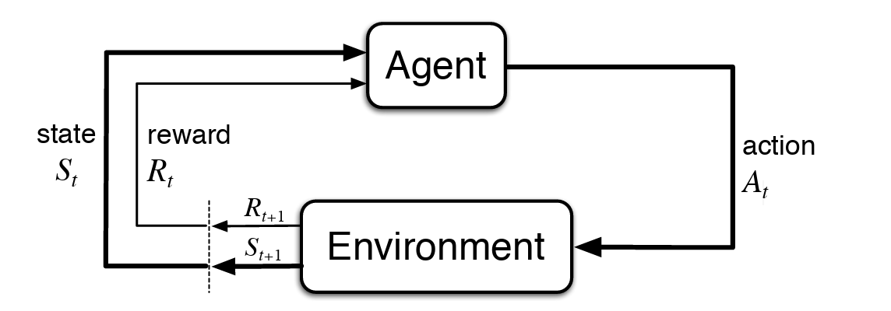
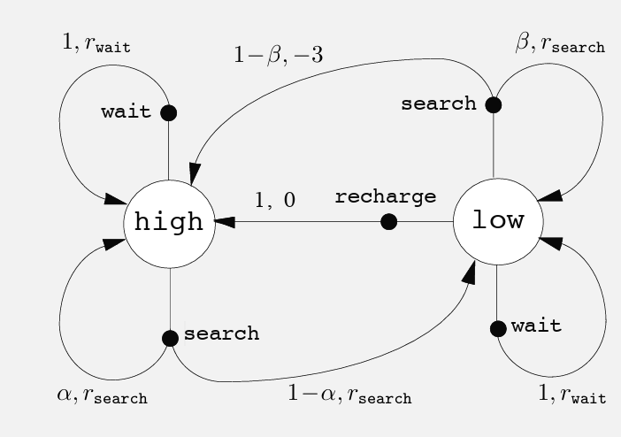
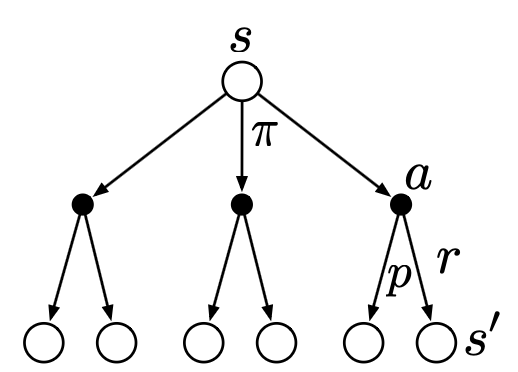
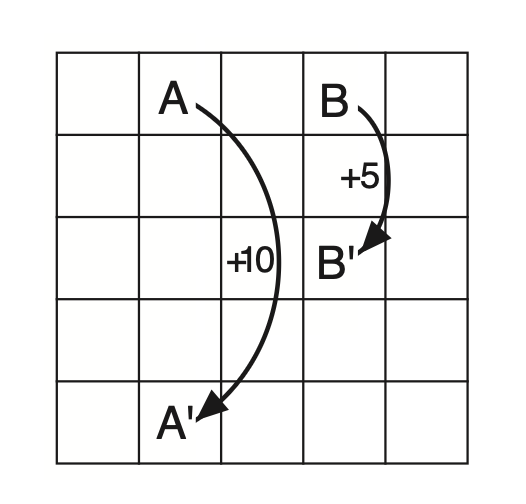
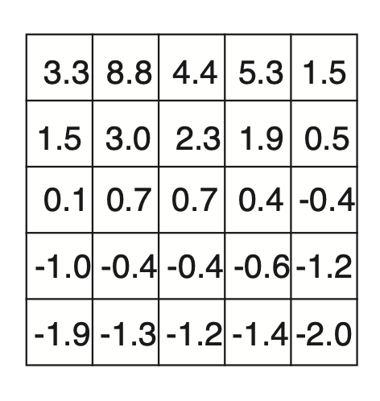

# Finite Markov Decision Processes

## A Primer: Conditional Probability and Conditional Expectation

It is worth getting comfortable with two ideas: **conditional probability** and **conditional expectation**. You have actually met the second one already. See the definition of an action's value, $q_*(a) = \mathbb{E}[R_t \mid A_t = a]$, in [A k-armed Bandit Problem](multi_armed_bandits.md#a-k-armed-bandit-problem).

The math pages ([Probability](../../math/probability/probability_and_counting.md) section of the math pages) write these as $P(A \mid B)$ and $E[X \mid Y]$; here we follow the reinforcement learning convention $\Pr\{A \mid B\}$ and $\mathbb{E}[X \mid Y]$. They mean the same thing.

### Conditional probability: shrink the world, then re-scale

The whole idea fits in one sentence: **to condition on $B$, throw away every outcome where $B$ did not happen, and re-scale what is left so it adds up to $1$.**

Suppose a cleaning robot logs its battery level (high or low) on $100$ consecutive steps, and also what its battery level was on the step after. The counts are:

| | Next: high | Next: low | Total |
|---|---|---|---|
| **Now: high** | $48$ | $12$ | $60$ |
| **Now: low** | $10$ | $30$ | $40$ |
| **Total** | $58$ | $42$ | $100$ |

*Without any condition*, the robot's battery is low next step on $42$ of the $100$ steps:

$$
\Pr\{\text{next low}\} = \frac{42}{100} = 0.42.
$$

*Given that the battery is high now*, we keep only the first row, $60$ steps, and ignore the rest. Of those $60$, the next battery was low on $12$:

$$
\Pr\{\text{next low} \mid \text{now high}\} = \frac{12}{60} = 0.2.
$$

Similarly, $\Pr\{\text{next low} \mid \text{now low}\} = \frac{30}{40} = 0.75$. Knowing the current battery level changes the odds a lot: from $0.42$ overall, to $0.2$ or $0.75$ depending on what we know.

Dividing the counts by $100$ turns this into the general definition. "Keep only the row" is the intersection $A \cap B$, and "re-scale" is dividing by $\Pr\{B\}$:

$$
\Pr\{A \mid B\} = \frac{\Pr\{A \cap B\}}{\Pr\{B\}}.
$$

Here $A$ is "next low" and $B$ is "now high". The intersection $\text{next low} \cap \text{now high}$ means both happened, so it is the single cell where the row "now high" meets the column "next low": $12$ of the $100$ steps. The condition "now high" is the whole first row: $60$ of the $100$ steps. So

$$
\Pr\{\text{next low} \mid \text{now high}\} = \frac{\Pr\{\text{next low} \cap \text{now high}\}}{\Pr\{\text{now high}\}} = \frac{12/100}{60/100} = \frac{0.12}{0.60} = 0.2,
$$

the same answer as counting within the row directly, $\frac{12}{60} = 0.2$.

Three facts follow:

1. **Given a condition, the probabilities of all outcomes add up to $1$.** $\Pr\{\text{next high} \mid \text{now high}\} + \Pr\{\text{next low} \mid \text{now high}\} = 0.8 + 0.2 = 1$. Each row of the table, re-scaled, is a full probability distribution of its own, called a **conditional distribution**.
2. **Law of total probability: the overall probability is a weighted average of the conditional ones**, weighted by how likely each condition is:

    $$
    \Pr\{\text{next low}\} = \underbrace{0.2}_{\Pr\{\text{low} \mid \text{high}\}} \cdot \underbrace{0.6}_{\Pr\{\text{high}\}} + \underbrace{0.75}_{\Pr\{\text{low} \mid \text{low}\}} \cdot \underbrace{0.4}_{\Pr\{\text{low}\}} = 0.12 + 0.30 = 0.42. \;\checkmark
    $$

3. **You can condition on several things at once.** $\Pr\{A \mid B, C\}$ means: keep only the outcomes where *both* $B$ and $C$ happened, then re-scale.

The **Markov property** is a statement about conditioning too. Once you know the current state and action, also knowing the earlier history does not change the probabilities,

$$
\Pr\{S_{t+1} = s' \mid S_t, A_t, S_{t-1}, A_{t-1}, \dots, S_0\} = \Pr\{S_{t+1} = s' \mid S_t, A_t\}.
$$

In other words, the future is **conditionally independent** of the past, given the present.

### Conditional expectation: the average inside the smaller world

Conditional expectation uses the same move. **To compute $\mathbb{E}[X \mid B]$, shrink the world to the outcomes where $B$ happened, and take the ordinary average of $X$ there:**

$$
\mathbb{E}[X \mid B] = \sum_x x \cdot \Pr\{X = x \mid B\}.
$$

It is the plain expectation $\mathbb{E}[X] = \sum_x x \cdot \Pr\{X = x\}$, with every probability replaced by its conditional version.

Back to the robot. Suppose that on each step it also earns a reward $R$ that depends on its current battery:

| Now | Possible rewards | $\mathbb{E}[R \mid \text{now}]$ |
|---|---|---|
| high | $4$ or $2$, each with probability $\tfrac{1}{2}$ | $\tfrac{1}{2} \cdot 4 + \tfrac{1}{2} \cdot 2 = 3$ |
| low | $1$ with probability $\tfrac{3}{4}$, or $-3$ (it runs flat and must be rescued) with probability $\tfrac{1}{4}$ | $\tfrac{3}{4} \cdot 1 + \tfrac{1}{4} \cdot (-3) = 0$ |

So $\mathbb{E}[R \mid \text{now high}] = 3$ and $\mathbb{E}[R \mid \text{now low}] = 0$. Each conditional expectation is just **a number: the average reward in that situation**. That is exactly what a value is in reinforcement learning, and it is how $q_*(a)$ was defined in the [bandit chapter](multi_armed_bandits.md#a-k-armed-bandit-problem).

When the condition is a random variable rather than a fixed event, as in $\mathbb{E}[R \mid S]$ with $S$ the current battery level, the result is a *function* of $S$: it equals $3$ when $S$ is high and $0$ when $S$ is low. Because $S$ is random, $\mathbb{E}[R \mid S]$ is itself a random variable.

Two properties to be thororugh with:

1. **Law of total expectation (Adam's law): the overall average is a weighted average of the conditional averages.**

    $$
    \mathbb{E}[R] = \sum_s \mathbb{E}[R \mid S = s] \cdot \Pr\{S = s\} = \underbrace{3}_{\text{high}} \cdot 0.6 + \underbrace{0}_{\text{low}} \cdot 0.4 = 1.8.
    $$

    In compact form, $\mathbb{E}\big[ \mathbb{E}[R \mid S] \big] = \mathbb{E}[R]$. As a check, computing directly from the overall reward distribution gives the same answer: $4 \cdot 0.3 + 2 \cdot 0.3 + 1 \cdot 0.3 + (-3) \cdot 0.1 = 1.8$.

2. **Taking out what's known.** Inside $\mathbb{E}[\,\cdot \mid S = s]$, anything that depends only on $s$ is a fixed number and can be pulled outside: $\mathbb{E}[h(S) \, R \mid S = s] = h(s) \, \mathbb{E}[R \mid S = s]$. We used this in the gradient bandit derivation, where $g(A_t)$ came out of $\mathbb{E}[\,\cdot \mid A_t = x]$ as the number $g(x)$.

### Cheat sheet

| Notation | Read as | Meaning |
|---|---|---|
| $\Pr\{A \mid B\}$ | probability of $A$ given $B$ | keep only outcomes where $B$ happened, re-scale, then ask how often $A$ happens |
| $\Pr\{A \mid B, C\}$ | probability of $A$ given $B$ and $C$ | same, keeping only outcomes where both $B$ and $C$ happened |
| $\mathbb{E}[X \mid B]$ | expected value of $X$ given $B$ | the average of $X$ over only the outcomes where $B$ happened (a number) |
| $\mathbb{E}[X \mid Y]$ | expected value of $X$ given $Y$ | the function of $Y$ that gives $\mathbb{E}[X \mid Y = y]$ for each $y$ (a random variable) |
| $\sum_b \Pr\{A \mid B = b\} \Pr\{B = b\}$ | law of total probability | equals $\Pr\{A\}$ |
| $\sum_y \mathbb{E}[X \mid Y = y] \Pr\{Y = y\}$ | law of total expectation | equals $\mathbb{E}[X]$ |

For the full treatment, with proofs and more examples, see the math pages:

- [Conditional Probability](../../math/probability/conditional_probability.md): the [definition](../../math/probability/conditional_probability.md#definition-of-conditional-probability), the [law of total probability](../../math/probability/conditional_probability.md#law-of-total-probability), and [conditional independence](../../math/probability/conditional_probability.md#conditional-independence), which is the idea behind the Markov property.
- [Conditional Distributions](../../math/probability/conditional_distributions.md): a whole distribution given a condition, like each re-scaled row of the table above.
- [Conditional Expectation](../../math/probability/conditional_expectation.md): the [definition](../../math/probability/conditional_expectation.md#definition-of-conditional-expectation) and the [general properties](../../math/probability/conditional_expectation.md#general-properties), including taking out what's known and iterated expectation (Adam's law).
- [Markov Chains](../../math/probability/markov_chains.md): the [transition matrix](../../math/probability/markov_chains.md#transition-matrix), where every row is a conditional distribution of the next state given the current one.

## The Agent–Environment Interface

MDPs are a classical formalization of **sequential decision making**, where actions influence not just immediate rewards, but also subsequent situations, or states, and through those future rewards. Thus MDPs involve **delayed reward** and the need to trade off immediate and delayed reward. Whereas in bandit problems we estimated the value $q_*(a)$ of each action $a$, in MDPs we estimate the value $q_*(s, a)$ of each action $a$ in each state $s$, or we estimate the value $v_*(s)$ of each state given optimal action selections.

| Value | Depends on | Question it answers |
|---|---|---|
| $q_*(a)$ | action $a$ | How good is action $a$? (bandits, where there is only one situation) |
| $q_*(s, a)$ | state $s$ and action $a$ | How good is taking action $a$ in state $s$, and acting optimally afterwards? |
| $v_*(s)$ | state $s$ | How good is being in state $s$, if we act optimally from here on? |

MDPs are meant to be a straightforward framing of the problem of learning from interaction to achieve a goal. The learner and decision maker is called the **agent**. The thing it interacts with, comprising everything outside the agent, is called the **environment**. These interact continually, the agent selecting actions and the environment responding to these actions and presenting new situations to the agent. The environment also gives rise to **rewards**, special numerical values that the agent seeks to maximize over time through its choice of actions.

More specifically, the agent and environment interact at each of a sequence of discrete time steps, $t = 0, 1, 2, 3, \dots$. At each time step $t$, the agent receives some representation of the environment’s **state**, $S_t \in \mathcal{S}$, and on that basis selects an **action**, $A_t \in \mathcal{A}(s)$. One time step later, in part as a consequence of its action, the agent receives a numerical **reward**, $R_{t+1} \in \mathcal{R} \subset \mathbb{R}$, and finds itself in a new state, $S_{t+1}$. The MDP and agent together thereby give rise to a sequence or **trajectory** that begins like this:

$$
S_0, A_0, R_1, S_1, A_1, R_2, S_2, A_2, R_3, \dots
$$

!!! note "Why is the reward $R_t$ in the bandit chapter but $R_{t+1}$ here?"
    It is only a difference in how the time steps are numbered. Both describe the same order of events: the agent takes an action, then receives its reward.

    In the [bandit chapter](multi_armed_bandits.md#a-k-armed-bandit-problem), the reward for action $A_t$ is called $R_t$, with the same index:

    $$
    A_1, R_1, \; A_2, R_2, \; A_3, R_3, \dots \qquad q_*(a) = \mathbb{E}[R_t \mid A_t = a].
    $$

    In an MDP, the action triggers **two** responses from the environment: a reward *and* a next state. They arrive together, so they get the same index, $t + 1$:

    $$
    \underbrace{S_t, A_t}_{\text{agent acts}} \;\longrightarrow\; \underbrace{R_{t+1}, S_{t+1}}_{\text{environment responds}}
    $$

    A bandit has no next state, so there is nothing for the reward to line up with, and the simpler "same index" naming is used.

    | | Bandit | MDP |
    |---|---|---|
    | reward for action $A_t$ | $R_t$ | $R_{t+1}$ |
    | expected reward of an action | $q_*(a) = \mathbb{E}[R_t \mid A_t = a]$ | $r(s, a) = \mathbb{E}[R_{t+1} \mid S_t = s, A_t = a]$ |
    | next state | none | $S_{t+1}$, arriving together with $R_{t+1}$ |

| Symbol | Meaning |
|---|---|
| $\mathcal{S}$ | the set of all possible states |
| $\mathcal{A}(s)$ | the set of actions available in state $s$ (it can differ from state to state) |
| $\mathcal{R} \subset \mathbb{R}$ | the set of possible rewards, a subset of the real numbers |

In a **finite MDP**, the sets of states, actions, and rewards ($\mathcal{S}$, $\mathcal{A}$, and $\mathcal{R}$) all have a finite number of elements. In this case, the random variables $R_t$ and $S_t$ have well defined discrete probability distributions dependent only on the preceding state and action. That is, for particular values of these random variables, $s' \in \mathcal{S}$ and $r \in \mathcal{R}$, there is a probability of those values occurring at time $t$, given particular values of the preceding state and action:

$$
p(s', r \mid s, a) \doteq \Pr\{S_t = s', R_t = r \mid S_{t-1} = s, A_{t-1} = a\},
$$

for all $s', s \in \mathcal{S}$, $r \in \mathcal{R}$, and $a \in \mathcal{A}(s)$. The function $p$ defines the **dynamics** of the MDP. The dot over the equals sign in the equation reminds us that it is a definition (in this case of the function $p$) rather than a fact that follows from previous definitions. The dynamics function

$$
p : \mathcal{S} \times \mathcal{R} \times \mathcal{S} \times \mathcal{A} \to [0, 1]
$$

is an ordinary deterministic function of four arguments.

This is a [conditional probability](#conditional-probability-shrink-the-world-then-re-scale) (keep only the moments when the agent was in state $s$ and took action $a$, and ask how often the next state was $s'$ and the reward was $r$). For each fixed $(s, a)$, the values $p(s', r \mid s, a)$ form a full probability distribution over the possible outcomes $(s', r)$.

$p$ specifies a probability distribution for each choice of $s$ and $a$, that is, that

$$
\sum_{s' \in \mathcal{S}} \sum_{r \in \mathcal{R}} p(s', r \mid s, a) = 1, \qquad \text{for all } s \in \mathcal{S}, \; a \in \mathcal{A}(s).
$$

In words: fix the current state $s$ and action $a$. Every possible outcome is some combination of a next state $s'$ and a reward $r$, and their probabilities, summed over all of these combinations, must add up to $1$. This is the first fact from the primer: given a condition, the probabilities of all outcomes add up to $1$.

In a Markov decision process, the probabilities given by $p$ completely characterize the environment’s dynamics. That is, the probability of each possible value for $S_t$ and $R_t$ depends on the immediately preceding state and action, $S_{t-1}$ and $A_{t-1}$, and, given them, not at all on earlier states and actions:

$$
\Pr\{S_t = s', R_t = r \mid S_{t-1}, A_{t-1}, S_{t-2}, A_{t-2}, \dots, S_0, A_0\} = \Pr\{S_t = s', R_t = r \mid S_{t-1}, A_{t-1}\} = p(s', r \mid S_{t-1}, A_{t-1}).
$$

This is best viewed as a restriction not on the decision process, but on the state. The state must include information about all aspects of the past agent–environment interaction that make a difference for the future. If it does, then the state is said to have the **Markov property**.

For example, the positions of all the pieces on a chess board are a Markov state: how the game reached that position makes no difference to what can happen next.

From the four-argument dynamics function, $p$, one can compute anything else one might want to know about the environment, such as the **state-transition probabilities** (which we denote, with a slight abuse of notation, as a three-argument function $p : \mathcal{S} \times \mathcal{S} \times \mathcal{A} \to [0, 1]$),

$$
p(s' \mid s, a) \doteq \Pr\{S_t = s' \mid S_{t-1} = s, A_{t-1} = a\} = \sum_{r \in \mathcal{R}} p(s', r \mid s, a).
$$

We can also compute the **expected rewards** for state–action pairs as a two-argument function $r : \mathcal{S} \times \mathcal{A} \to \mathbb{R}$:

$$
r(s, a) \doteq \mathbb{E}[R_t \mid S_{t-1} = s, A_{t-1} = a] = \sum_{r \in \mathcal{R}} r \sum_{s' \in \mathcal{S}} p(s', r \mid s, a),
$$

and the expected rewards for state–action–next-state triples as a three-argument function $r : \mathcal{S} \times \mathcal{A} \times \mathcal{S} \to \mathbb{R}$,

$$
r(s, a, s') \doteq \mathbb{E}[R_t \mid S_{t-1} = s, A_{t-1} = a, S_t = s'] = \sum_{r \in \mathcal{R}} r \, \frac{p(s', r \mid s, a)}{p(s' \mid s, a)}.
$$

Both are [conditional expectations](#conditional-expectation-the-average-inside-the-smaller-world): the average reward, over only the moments that match the condition. To see where the formulas come from, start from the definition $\mathbb{E}[R_t \mid \text{condition}] = \sum_r r \cdot \Pr\{R_t = r \mid \text{condition}\}$, and find that conditional probability of the reward.

For $r(s, a)$, the reward $r$ can arrive together with any next state $s'$, so we add up over all of them:

$$
\Pr\{R_t = r \mid S_{t-1} = s, A_{t-1} = a\} = \sum_{s' \in \mathcal{S}} p(s', r \mid s, a).
$$

For $r(s, a, s')$, we also know the next state. By the definition of conditional probability, we divide the probability of "this $s'$ and this $r$" by the probability of "this $s'$":

$$
\Pr\{R_t = r \mid S_{t-1} = s, A_{t-1} = a, S_t = s'\} = \frac{\Pr\{S_t = s', R_t = r \mid S_{t-1} = s, A_{t-1} = a\}}{\Pr\{S_t = s' \mid S_{t-1} = s, A_{t-1} = a\}} = \frac{p(s', r \mid s, a)}{p(s' \mid s, a)}.
$$

Multiplying each by $r$ and summing over $r$ gives the two formulas above.

The MDP framework is abstract and flexible and can be applied to many different problems in many different ways. For example, the time steps $t = 0, 1, 2, \dots$ need not refer to fixed intervals of real time; they can refer to arbitrary successive stages of decision making and acting. The actions $A_t$ can be low-level controls, such as the voltages applied to the motors of a robot arm, or high-level decisions, such as whether or not to have lunch or to go to graduate school. Similarly, the states $S_t$ can take a wide variety of forms. They can be completely determined by low-level sensations, such as direct sensor readings, or they can be more high-level and abstract, such as symbolic descriptions of objects in a room. In general, **actions can be any decisions we want to learn how to make, and states can be anything we can know that might be useful in making them.**

In particular, the boundary between agent and environment is typically not the same as the physical boundary of a robot’s or an animal’s body. Usually, the boundary is drawn closer to the agent than that. For example, the motors and mechanical linkages of a robot and its sensing hardware should usually be considered parts of the environment rather than parts of the agent. Similarly, if we apply the MDP framework to a person or animal, the muscles, skeleton, and sensory organs should be considered part of the environment. Rewards, too, presumably are computed inside the physical bodies of natural and artificial learning systems, but are considered external to the agent.

The general rule we follow is that **anything that cannot be changed arbitrarily by the agent is considered to be outside of it and thus part of its environment**. We do not assume that everything in the environment is unknown to the agent. For example, the agent often knows quite a bit about how its rewards are computed as a function of its actions and the states in which they are taken. But we always consider the reward computation to be external to the agent. **The agent–environment boundary represents the limit of the agent’s absolute control, not of its knowledge.**

The MDP framework is a considerable abstraction of the problem of goal-directed learning from interaction. It proposes that whatever the details of the sensory, memory, and control apparatus, and whatever objective one is trying to achieve, any problem of learning goal-directed behavior can be reduced to three signals passing back and forth between an agent and its environment:

- one signal to represent the choices made by the agent (the **actions**, $A_t$),
- one signal to represent the basis on which the choices are made (the **states**, $S_t$), and
- one signal to define the agent’s goal (the **rewards**, $R_{t+1}$).

This framework may not be sufficient to represent all decision-learning problems usefully, but it has proved to be widely useful and applicable.

**Example: Recycling Robot:** A mobile robot has the job of collecting empty soda cans in an office environment. It has sensors for detecting cans, and an arm and gripper that can pick them up and place them in an onboard bin; it runs on a rechargeable battery. The robot’s control system has components for interpreting sensory information, for navigating, and for controlling the arm and gripper. High-level decisions about how to search for cans are made by a reinforcement learning agent based on the current charge level of the battery.

To make a simple example, we assume that only two charge levels can be distinguished, comprising a small state set $\mathcal{S} = \{\texttt{high}, \texttt{low}\}$. In each state, the agent can decide whether to (1) actively $\texttt{search}$ for a can for a certain period of time, (2) remain stationary and $\texttt{wait}$ for someone to bring it a can, or (3) head back to its home base to $\texttt{recharge}$ its battery. When the energy level is high, recharging would always be foolish, so we do not include it in the action set for this state. The action sets are then

$$
\mathcal{A}(\texttt{high}) = \{\texttt{search}, \texttt{wait}\}, \qquad \mathcal{A}(\texttt{low}) = \{\texttt{search}, \texttt{wait}, \texttt{recharge}\}.
$$

The rewards are zero most of the time, but become positive when the robot secures an empty can, or large and negative if the battery runs all the way down. The best way to find cans is to actively search for them, but this runs down the robot’s battery, whereas waiting does not. Whenever the robot is searching, the possibility exists that its battery will become depleted. In this case the robot must shut down and wait to be rescued (producing a low reward).

If the energy level is high, then a period of active search can always be completed without risk of depleting the battery. A period of searching that begins with a high energy level leaves the energy level high with probability $\alpha$ and reduces it to low with probability $1 - \alpha$. On the other hand, a period of searching undertaken when the energy level is low leaves it low with probability $\beta$ and depletes the battery with probability $1 - \beta$. In the latter case, the robot must be rescued, and the battery is then recharged back to high.

Each can collected by the robot counts as a unit reward, whereas a reward of $-3$ results whenever the robot has to be rescued. Let $r_{\texttt{search}}$ and $r_{\texttt{wait}}$, with $r_{\texttt{search}} > r_{\texttt{wait}}$, denote the expected number of cans the robot will collect (and hence the expected reward) while searching and while waiting respectively. Finally, suppose that no cans can be collected during a run home for recharging, and that no cans can be collected on a step in which the battery is depleted.

This system is then a finite MDP, and we can write down the transition probabilities $p(s' \mid s, a)$ and the expected rewards $r(s, a, s')$, with dynamics as indicated in the table:

| $s$ | $a$ | $s'$ | $p(s' \mid s, a)$ | $r(s, a, s')$ |
|---|---|---|---|---|
| $\texttt{high}$ | $\texttt{search}$ | $\texttt{high}$ | $\alpha$ | $r_{\texttt{search}}$ |
| $\texttt{high}$ | $\texttt{search}$ | $\texttt{low}$ | $1 - \alpha$ | $r_{\texttt{search}}$ |
| $\texttt{low}$ | $\texttt{search}$ | $\texttt{high}$ | $1 - \beta$ | $-3$ |
| $\texttt{low}$ | $\texttt{search}$ | $\texttt{low}$ | $\beta$ | $r_{\texttt{search}}$ |
| $\texttt{high}$ | $\texttt{wait}$ | $\texttt{high}$ | $1$ | $r_{\texttt{wait}}$ |
| $\texttt{high}$ | $\texttt{wait}$ | $\texttt{low}$ | $0$ | $-$ |
| $\texttt{low}$ | $\texttt{wait}$ | $\texttt{high}$ | $0$ | $-$ |
| $\texttt{low}$ | $\texttt{wait}$ | $\texttt{low}$ | $1$ | $r_{\texttt{wait}}$ |
| $\texttt{low}$ | $\texttt{recharge}$ | $\texttt{high}$ | $1$ | $0$ |
| $\texttt{low}$ | $\texttt{recharge}$ | $\texttt{low}$ | $0$ | $-$ |

Note that there is a row in the table for each possible combination of current state, $s$, action, $a \in \mathcal{A}(s)$, and next state, $s'$. Some transitions have zero probability of occurring, so no expected reward is specified for them ($-$). For each fixed $(s, a)$, the probabilities $p(s' \mid s, a)$ add up to $1$, as they must.

## Goals and Rewards

In reinforcement learning, the purpose or goal of the agent is formalized in terms of a special signal, called the **reward**, passing from the environment to the agent. At each time step, the reward is a simple number, $R_t \in \mathbb{R}$. Informally, the agent’s goal is to maximize the total amount of reward it receives. This means maximizing not immediate reward, but cumulative reward in the long run:

$$
\text{maximize} \quad \mathbb{E}\big[ R_{t+1} + R_{t+2} + R_{t+3} + \cdots \big] \qquad \text{rather than just} \quad \mathbb{E}\big[ R_{t+1} \big].
$$

We can clearly state this informal idea as the **reward hypothesis**:

> That all of what we mean by goals and purposes can be well thought of as the maximization of the expected value of the cumulative sum of a received scalar signal (called reward).

The use of a reward signal to formalize the idea of a goal is one of the most distinctive features of reinforcement learning.

## Returns and Episodes

We have said that the agent’s goal is to maximize the cumulative reward it receives in the long run. How might this be defined formally? If the sequence of rewards received after time step $t$ is denoted $R_{t+1}, R_{t+2}, R_{t+3}, \dots$, then what precise aspect of this sequence do we wish to maximize? In general, we seek to maximize the **expected return**, where the **return**, denoted $G_t$, is defined as some specific function of the reward sequence. In the simplest case the return is the sum of the rewards:

$$
G_t \doteq R_{t+1} + R_{t+2} + R_{t+3} + \cdots + R_T = \sum_{k=t+1}^{T} R_k,
$$

where $T$ is a final time step. This approach makes sense in applications in which there is a natural notion of final time step, that is, when the agent–environment interaction breaks naturally into subsequences, which we call **episodes**, such as plays of a game, trips through a maze, or any sort of repeated interaction. Each episode ends in a special state called the **terminal state**, followed by a reset to a standard starting state or to a sample from a standard distribution of starting states. Even if you think of episodes as ending in different ways, such as winning and losing a game, the next episode begins independently of how the previous one ended. Thus the episodes can all be considered to end in the same terminal state, with different rewards for the different outcomes.

Tasks (task is the whole problem the agent is trying to solve; and an action is a single choice the agent makes at one time step) with episodes of this kind are called **episodic tasks**. In episodic tasks we sometimes need to distinguish the set of all nonterminal states, denoted $\mathcal{S}$, from the set of all states plus the terminal state, denoted $\mathcal{S}^+$:

$$
\mathcal{S}^+ = \mathcal{S} \cup \{\text{terminal}\}.
$$

The time of termination, $T$, is a random variable that normally varies from episode to episode. For example, one game of chess might end after $T = 40$ moves and the next after $T = 63$.

On the other hand, in many cases the agent–environment interaction does not break naturally into identifiable episodes, but goes on continually without limit. We call these **continuing tasks**. The return formulation above is problematic for continuing tasks because the final time step would be $T = \infty$, and the return, which is what we are trying to maximize, could easily be infinite. For example, if the agent receives a reward of $+1$ on every step forever, then $G_t = 1 + 1 + 1 + \cdots = \infty$, and every way of behaving that earns $+1$ per step looks equally (infinitely) good.

The additional concept that we need is that of **discounting**. According to this approach, the agent tries to select actions so that the sum of the discounted rewards it receives over the future is maximized. In particular, it chooses $A_t$ to maximize the expected **discounted return**:

$$
G_t \doteq R_{t+1} + \gamma R_{t+2} + \gamma^2 R_{t+3} + \cdots = \sum_{k=0}^{\infty} \gamma^k R_{t+k+1},
$$

where $\gamma$ is a parameter, $0 \leq \gamma \leq 1$, called the **discount rate**.

With the same reward of $+1$ on every step, the discounted return is now a finite geometric series. For example, with $\gamma = 0.9$,

$$
G_t = 1 + 0.9 + 0.9^2 + \cdots = \sum_{k=0}^{\infty} 0.9^k = \frac{1}{1 - 0.9} = 10.
$$

The discount rate determines the **present value** of future rewards: a reward received $k$ time steps in the future is worth only $\gamma^{k-1}$ times what it would be worth if it were received immediately. If $\gamma = 0$, the agent is “myopic” in being concerned only with maximizing immediate rewards: its objective in this case is to learn how to choose $A_t$ so as to maximize only $R_{t+1}$, since then $G_t = R_{t+1}$.

As $\gamma$ approaches $1$, the return objective takes future rewards into account more strongly; the agent becomes more farsighted. Returns at successive time steps are related to each other in a way that is important for the theory and algorithms of reinforcement learning:

$$
\begin{aligned}
G_t &\doteq R_{t+1} + \gamma R_{t+2} + \gamma^2 R_{t+3} + \gamma^3 R_{t+4} + \cdots \\
&= R_{t+1} + \gamma \big( R_{t+2} + \gamma R_{t+3} + \gamma^2 R_{t+4} + \cdots \big) \\
&= R_{t+1} + \gamma G_{t+1}.
\end{aligned}
$$

Note that although the discounted return is a sum of an infinite number of terms, it is still finite if the reward is nonzero and constant, if $\gamma < 1$. For example, if the reward is a constant $+1$, then the return is

$$
G_t = \sum_{k=0}^{\infty} \gamma^k = \frac{1}{1 - \gamma}.
$$

!!! note "It’s a guarantee that the discounted return can’t blow up to infinity. It needs two conditions."
    **Bounded** means the rewards never exceed some fixed size: there is a number $R_{\max}$ with $|R_k| \leq R_{\max}$ for every $k$. The rewards can still vary; they just cannot grow without limit.

    Each term of the return is then at most $\gamma^k R_{\max}$ in size, so the return is at most a geometric series:

    $$
    |G_t| \leq \sum_{k=0}^{\infty} \gamma^k R_{\max} = \frac{R_{\max}}{1 - \gamma},
    $$

    which is finite when $\gamma < 1$. For example, with rewards between $-10$ and $10$ and $\gamma = 0.9$, the return always lies between $-100$ and $100$.

    Both conditions are needed:

    - **Without $\gamma < 1$:** with $\gamma = 1$ and a reward of $+1$ on every step, $G_t = 1 + 1 + 1 + \cdots = \infty$.
    - **Without bounded rewards:** with $\gamma = 0.9$ and rewards growing as $1, \frac{1}{0.9}, \frac{1}{0.9^2}, \dots$, every discounted term equals $1$, so again $G_t = \infty$.

## Unified Notation for Episodic and Continuing Tasks

Rather than one long sequence of time steps, we need to consider a series of episodes, each of which consists of a finite sequence of time steps. We number the time steps of each episode starting anew from zero. Therefore, we have to refer not just to $S_t$, the state representation at time $t$, but to $S_{t,i}$, the state representation at time $t$ of episode $i$ (and similarly for $A_{t,i}$, $R_{t,i}$, $\pi_{t,i}$, $T_i$, etc.).

For example, if the first episode lasts $T_1 = 3$ steps and the second lasts $T_2 = 2$ steps, the states are

$$
\underbrace{S_{0,1}, \; S_{1,1}, \; S_{2,1}, \; S_{3,1}}_{\text{episode } 1} \qquad \underbrace{S_{0,2}, \; S_{1,2}, \; S_{2,2}}_{\text{episode } 2}
$$

where the time step $t$ restarts at $0$ in each episode, and the last state of each episode is the terminal state.

However, it turns out that when we discuss episodic tasks we almost never have to distinguish between different episodes. We are almost always considering a particular episode, or stating something that is true for all episodes. Accordingly, in practice we almost always abuse notation slightly by dropping the explicit reference to episode number. That is, we write $S_t$ to refer to $S_{t,i}$, and so on.

We need one other convention to obtain a single notation that covers both episodic and continuing tasks. We can write

$$
G_t \doteq \sum_{k=t+1}^{T} \gamma^{k-t-1} R_k,
$$

including the possibility that $T = \infty$ or $\gamma = 1$ (but not both).

This one formula covers both earlier definitions of the return:

- **Episodic task** ($T$ finite, $\gamma = 1$): $G_t = R_{t+1} + R_{t+2} + \cdots + R_T$, the plain sum of rewards until the episode ends.
- **Continuing task** ($T = \infty$, $\gamma < 1$): $G_t = R_{t+1} + \gamma R_{t+2} + \gamma^2 R_{t+3} + \cdots$, the discounted return. Substituting $k = t + 1 + j$ turns $\gamma^{k-t-1} R_k$ into $\gamma^{j} R_{t+j+1}$, which is the earlier form $\sum_{j=0}^{\infty} \gamma^j R_{t+j+1}$.

## Policies and Value Functions

Almost all reinforcement learning algorithms involve estimating **value functions**: functions of states (or of state–action pairs) that estimate how good it is for the agent to be in a given state (or how good it is to perform a given action in a given state). The notion of “how good” here is defined in terms of future rewards that can be expected, or, to be precise, in terms of expected return.

Formally, a **policy** is a mapping from states to probabilities of selecting each possible action. If the agent is following policy $\pi$ at time $t$, then $\pi(a \mid s)$ is the probability that $A_t = a$ if $S_t = s$:

$$
\pi(a \mid s) = \Pr\{A_t = a \mid S_t = s\}.
$$

Like $p$, $\pi$ is an ordinary function; the “$\mid$” in the middle of $\pi(a \mid s)$ merely reminds us that it defines a probability distribution over $a \in \mathcal{A}(s)$ for each $s \in \mathcal{S}$:

$$
\sum_{a \in \mathcal{A}(s)} \pi(a \mid s) = 1, \qquad \text{for all } s \in \mathcal{S}.
$$

For example, one possible policy for the recycling robot is:

| $s$ | $\pi(\texttt{search} \mid s)$ | $\pi(\texttt{wait} \mid s)$ | $\pi(\texttt{recharge} \mid s)$ |
|---|---|---|---|
| $\texttt{high}$ | $0.9$ | $0.1$ | $-$ |
| $\texttt{low}$ | $0.2$ | $0.3$ | $0.5$ |

Each row is a probability distribution over the actions available in that state, so it adds up to $1$($\texttt{recharge}$ is not available in $\texttt{high}$).

The **value function** of a state $s$ under a policy $\pi$, denoted $v_\pi(s)$, is the expected return when starting in $s$ and following $\pi$ thereafter. For MDPs, we can define $v_\pi$ formally by

$$
v_\pi(s) \doteq \mathbb{E}_\pi[G_t \mid S_t = s] = \mathbb{E}_\pi\left[ \sum_{k=0}^{\infty} \gamma^k R_{t+k+1} \,\middle|\, S_t = s \right], \qquad \text{for all } s \in \mathcal{S},
$$

where $\mathbb{E}_\pi[\cdot]$ denotes the expected value of a random variable given that the agent follows policy $\pi$, and $t$ is any time step. Note that the value of the terminal state, if any, is always zero. We call the function $v_\pi$ the **state-value function for policy $\pi$**.

Similarly, we define the value of taking action $a$ in state $s$ under a policy $\pi$, denoted $q_\pi(s, a)$, as the expected return starting from $s$, taking the action $a$, and thereafter following policy $\pi$:

$$
q_\pi(s, a) \doteq \mathbb{E}_\pi[G_t \mid S_t = s, A_t = a] = \mathbb{E}_\pi\left[ \sum_{k=0}^{\infty} \gamma^k R_{t+k+1} \,\middle|\, S_t = s, A_t = a \right].
$$

We call $q_\pi$ the **action-value function for policy $\pi$**.

!!! note "Comparing $q_*(a)$ from bandits, $r(s, a)$ and $q_\pi(s, a)$"
    All three are "the value of an action", but they look ahead different distances:

    | | Definition | Looks at | Needs a policy? |
    |---|---|---|---|
    | $q_*(a)$, [bandit](multi_armed_bandits.md#a-k-armed-bandit-problem) | $\mathbb{E}[R_t \mid A_t = a]$ | the one reward from action $a$ | no |
    | $r(s, a)$, MDP | $\mathbb{E}[R_{t+1} \mid S_t = s, A_t = a]$ | the one immediate reward from action $a$ in state $s$ | no |
    | $q_\pi(s, a)$, MDP | $\mathbb{E}_\pi[G_t \mid S_t = s, A_t = a]$ | all future rewards, discounted | **yes**: $\pi$ is followed after the first action |

    **$r(s, a)$ is the MDP version of the bandit's $q_*(a)$.** Both average only the reward that comes right after the action, so neither depends on what the agent does next. The only difference is that $r(s, a)$ also depends on the state.

    **$q_\pi(s, a)$ also counts everything that happens afterwards.** In an MDP, the action changes the next state, and the reward from then on depends on how the agent keeps playing. That is why $q_\pi$ needs a policy $\pi$ for "afterwards", and why it can differ from one policy to another.

Both are [conditional expectations](#conditional-expectation-the-average-inside-the-smaller-world): the average return, over only the moments that match the condition. $v_\pi(s)$ averages over everything that can happen from $s$, including which action is taken first, while $q_\pi(s, a)$ also fixes the first action to $a$. The two are linked by the [law of total expectation](#conditional-expectation-the-average-inside-the-smaller-world): the value of a state is the average of its action values, weighted by how likely the policy is to pick each action,

$$
v_\pi(s) = \sum_{a \in \mathcal{A}(s)} \pi(a \mid s) \, q_\pi(s, a).
$$

**Short derivation, using the law of total expectation:** We need the law with everything also conditioned on the current state. For random variables $X$ and $Y$ and a condition $C$,

$$
\mathbb{E}[X \mid C] = \sum_y \Pr\{Y = y \mid C\} \, \mathbb{E}[X \mid Y = y, C].
$$

This is the same [law of total expectation](#conditional-expectation-the-average-inside-the-smaller-world), applied inside the smaller world where $C$ holds.

Take $X = G_t$ (the return), $Y = A_t$ (the first action), and $C$ to be $S_t = s$ (the current state):

$$
\mathbb{E}_\pi[G_t \mid S_t = s] = \sum_a \Pr\{A_t = a \mid S_t = s\} \, \mathbb{E}_\pi[G_t \mid S_t = s, A_t = a].
$$

Each piece is something already defined:

- $\mathbb{E}_\pi[G_t \mid S_t = s] = v_\pi(s)$, by the definition of the state-value function;
- $\Pr\{A_t = a \mid S_t = s\} = \pi(a \mid s)$, since the policy is what chooses the action in state $s$;
- $\mathbb{E}_\pi[G_t \mid S_t = s, A_t = a] = q_\pi(s, a)$, by the definition of the action-value function.

Substituting all three gives

$$
v_\pi(s) = \sum_{a \in \mathcal{A}(s)} \pi(a \mid s) \, q_\pi(s, a).
$$

!!! note "Connection to the bandit chapter"
    This is the same argument as the [bandit result](multi_armed_bandits.md#the-bandit-gradient-algorithm-as-stochastic-gradient-ascent) $\mathbb{E}[R_t] = \sum_x \pi_t(x) \, q_*(x)$, with two changes:

    | | Bandit | MDP |
    |---|---|---|
    | condition | none (there is only one situation) | $S_t = s$ |
    | quantity being averaged | immediate reward $R_t$ | full return $G_t$ |
    | result | $\mathbb{E}[R_t] = \sum_x \pi_t(x) \, q_*(x)$ | $v_\pi(s) = \sum_a \pi(a \mid s) \, q_\pi(s, a)$ |

So **the value of a state is the policy-weighted average of its action values.** For example, if in some state $s$ the policy picks $\texttt{search}$ with probability $0.9$ and $\texttt{wait}$ with probability $0.1$, and $q_\pi(s, \texttt{search}) = 10$ while $q_\pi(s, \texttt{wait}) = 4$, then

$$
v_\pi(s) = 0.9 \cdot 10 + 0.1 \cdot 4 = 9.4.
$$

A fundamental property of value functions used throughout reinforcement learning and dynamic programming is that they satisfy recursive relationships similar to the one we established for the return, $G_t = R_{t+1} + \gamma G_{t+1}$. For any policy $\pi$ and any state $s$, the following consistency condition holds between the value of $s$ and the value of its possible successor states. We derive it in steps.

**Step 1: use the recursion for the return:** By definition, and since $G_t = R_{t+1} + \gamma G_{t+1}$,

$$
v_\pi(s) \doteq \mathbb{E}_\pi[G_t \mid S_t = s] = \mathbb{E}_\pi[R_{t+1} + \gamma G_{t+1} \mid S_t = s].
$$

**Step 2: split by what happens on the next step:** Starting from $S_t = s$, one step of interaction produces three random things: the action $A_t$, the next state $S_{t+1}$, and the reward $R_{t+1}$. By the [law of total expectation](#conditional-expectation-the-average-inside-the-smaller-world), we can average over every possible combination $(a, s', r)$, weighting each by its probability:

$$
v_\pi(s) = \sum_a \sum_{s'} \sum_r \underbrace{\Pr\{A_t = a, S_{t+1} = s', R_{t+1} = r \mid S_t = s\}}_{\text{how likely this combination is}} \; \underbrace{\mathbb{E}_\pi\big[ R_{t+1} + \gamma G_{t+1} \mid S_t = s, A_t = a, S_{t+1} = s', R_{t+1} = r \big]}_{\text{average return, given this combination}}.
$$

**Step 3: the probability of each combination:** By the multiplication rule, conditioned on $S_t = s$ throughout: first the agent picks $a$, then the environment responds with $(s', r)$:

$$
\Pr\{A_t = a, S_{t+1} = s', R_{t+1} = r \mid S_t = s\} = \underbrace{\Pr\{A_t = a \mid S_t = s\}}_{= \, \pi(a \mid s)} \cdot \underbrace{\Pr\{S_{t+1} = s', R_{t+1} = r \mid S_t = s, A_t = a\}}_{= \, p(s', r \mid s, a)}.
$$

The first factor is the policy, and the second is the dynamics of the MDP.

**Step 4: the average return, given the combination:** By linearity, split the expectation into its two parts:

$$
\mathbb{E}_\pi\big[ R_{t+1} + \gamma G_{t+1} \mid \cdots \big] = \mathbb{E}_\pi\big[ R_{t+1} \mid \cdots \big] + \gamma \, \mathbb{E}_\pi\big[ G_{t+1} \mid \cdots \big],
$$

where "$\cdots$" stands for the full condition $S_t = s, A_t = a, S_{t+1} = s', R_{t+1} = r$.

- **The reward part:** The condition includes $R_{t+1} = r$, so the reward is known and is just the number $r$: $\mathbb{E}_\pi[R_{t+1} \mid \cdots] = r$.
- **The future part:** $G_{t+1} = R_{t+2} + \gamma R_{t+3} + \cdots$ only involves what happens from time $t + 1$ onward. By the **Markov property**, once we know the state $S_{t+1} = s'$, the earlier state, action and reward make no difference to what happens next, and the agent keeps choosing actions with $\pi$, which also looks only at the current state. So we can drop them from the condition:

    $$
    \mathbb{E}_\pi\big[ G_{t+1} \mid S_t = s, A_t = a, S_{t+1} = s', R_{t+1} = r \big] = \mathbb{E}_\pi\big[ G_{t+1} \mid S_{t+1} = s' \big] = v_\pi(s').
    $$

    The last equality is the definition of $v_\pi$, applied at time $t + 1$ instead of $t$. This is allowed because $v_\pi$ is defined the same way at every time step.

Putting the two parts together, the average return given the combination is

$$
\mathbb{E}_\pi\big[ R_{t+1} + \gamma G_{t+1} \mid S_t = s, A_t = a, S_{t+1} = s', R_{t+1} = r \big] = r + \gamma \, v_\pi(s').
$$

**Step 5: substitute back in:** Putting Steps 3 and 4 into Step 2:

$$
\begin{aligned}
v_\pi(s) &= \sum_a \sum_{s'} \sum_r \pi(a \mid s) \, p(s', r \mid s, a) \Big[ r + \gamma \, v_\pi(s') \Big] \\
&= \sum_a \pi(a \mid s) \sum_{s'} \sum_r p(s', r \mid s, a) \Big[ r + \gamma \, v_\pi(s') \Big] && \text{(move } \pi(a \mid s) \text{ out: it does not depend on } s' \text{ or } r\text{)} \\
&= \sum_a \pi(a \mid s) \sum_{s', r} p(s', r \mid s, a) \Big[ r + \gamma \, v_\pi(s') \Big], \qquad \text{for all } s \in \mathcal{S}. && \text{(merge the two sums)}
\end{aligned}
$$

Here it is implicit that the actions, $a$, are taken from the set $\mathcal{A}(s)$, that the next states, $s'$, are taken from the set $\mathcal{S}$ (or from $\mathcal{S}^+$ in the case of an episodic problem), and that the rewards, $r$, are taken from the set $\mathcal{R}$. Note also how in the last line we have merged the two sums, one over all the values of $s'$ and the other over all the values of $r$, into one sum over all the possible values of both. We use this kind of merged sum often to simplify formulas.

Note how the final expression can be read easily as an expected value. It is really a sum over all values of the three variables, $a$, $s'$, and $r$. For each triple, we compute its probability, $\pi(a \mid s) \, p(s', r \mid s, a)$, weight the quantity in brackets by that probability, then sum over all possibilities to get an expected value.

This equation is the **Bellman equation for $v_\pi$**. It expresses a relationship between the value of a state and the values of its successor states: the value of $s$ is the expected immediate reward, plus the discounted value of wherever we land next.

It expresses a relationship between the value of a state and the values of its successor states. Think of looking ahead from a state to its possible successor states, as suggested by the diagram below.

**The Bellman equation averages over all the possibilities, weighting each by its probability of occurring. It states that the value of the start state must equal the (discounted) value of the expected next state, plus the reward expected along the way.**

The value function $v_\pi$ is the **unique solution** to its Bellman equation.

What this means is that **the Bellman equation is not one equation but one equation for each state**. If there are $|\mathcal{S}|$ states, we get $|\mathcal{S}|$ equations, and the unknowns are the $|\mathcal{S}|$ numbers $v_\pi(s)$. Each equation is linear in these unknowns, since the $v_\pi(s')$ appear only multiplied by fixed numbers $\gamma \, \pi(a \mid s) \, p(s', r \mid s, a)$. Saying that $v_\pi$ is the *unique* solution means that exactly one set of numbers satisfies all the equations at once, and that set is $v_\pi$.

For example, take the recycling robot with $\alpha = 0.8$, $r_{\texttt{search}} = 2$, $\gamma = 0.9$, and the policy "always $\texttt{search}$ when $\texttt{high}$, always $\texttt{recharge}$ when $\texttt{low}$". The Bellman equation gives one equation per state:

$$
\begin{aligned}
v_\pi(\texttt{high}) &= \underbrace{0.8 \big[ 2 + 0.9 \, v_\pi(\texttt{high}) \big]}_{\text{stays high}} + \underbrace{0.2 \big[ 2 + 0.9 \, v_\pi(\texttt{low}) \big]}_{\text{drops to low}} = 2 + 0.72 \, v_\pi(\texttt{high}) + 0.18 \, v_\pi(\texttt{low}), \\
v_\pi(\texttt{low}) &= \underbrace{1 \cdot \big[ 0 + 0.9 \, v_\pi(\texttt{high}) \big]}_{\text{recharges to high}} = 0.9 \, v_\pi(\texttt{high}).
\end{aligned}
$$

Two equations, two unknowns. Substituting the second into the first,

$$
v_\pi(\texttt{high}) = 2 + 0.72 \, v_\pi(\texttt{high}) + 0.162 \, v_\pi(\texttt{high}) \quad \Longrightarrow \quad v_\pi(\texttt{high}) = \frac{2}{1 - 0.882} \approx 16.95,
$$

and then $v_\pi(\texttt{low}) = 0.9 \cdot 16.95 \approx 15.25$. No other pair of numbers satisfies both equations, so these are the values of this policy.

**Example: Gridworld:** The figure below (left) shows a rectangular gridworld representation of a simple finite MDP. The cells of the grid correspond to the states of the environment. At each cell, four actions are possible: $\texttt{north}$, $\texttt{south}$, $\texttt{east}$, and $\texttt{west}$, which deterministically cause the agent to move one cell in the respective direction on the grid. Actions that would take the agent off the grid leave its location unchanged, but also result in a reward of $-1$. Other actions result in a reward of $0$, except those that move the agent out of the special states $A$ and $B$. From state $A$, all four actions yield a reward of $+10$ and take the agent to $A'$. From state $B$, all actions yield a reward of $+5$ and take the agent to $B'$.
{: #gridworld }

| Move | Reward | Next state |
|---|---|---|
| out of $A$ (any action) | $+10$ | $A'$ |
| out of $B$ (any action) | $+5$ | $B'$ |
| off the edge of the grid | $-1$ | unchanged |
| any other move | $0$ | the neighboring cell |

Suppose the agent selects all four actions with equal probability in all states, $\pi(a \mid s) = \frac{1}{4}$ for every $a$ and $s$. The figure above (right) shows the value function, $v_\pi$, for this policy, for the discounted reward case with $\gamma = 0.9$. This value function was computed by solving the system of linear equations given by the [Bellman equation for $v_\pi$](#policies-and-value-functions), one equation per cell. Notice the negative values near the lower edge; these are the result of the high probability of hitting the edge of the grid there under the random policy. State $A$ is the best state to be in under this policy. Note that $A$’s expected return is less than its immediate reward of $10$, because from $A$ the agent is taken to state $A'$ from which it is likely to run into the edge of the grid. State $B$, on the other hand, is valued more than its immediate reward of $5$, because from $B$ the agent is taken to $B'$ which has a positive value.

## Optimal Policies and Optimal Value Functions

For finite MDPs, we can precisely define an optimal policy in the following way. Value functions define a **partial ordering** over policies. A policy $\pi$ is defined to be better than or equal to a policy $\pi'$ if its expected return is greater than or equal to that of $\pi'$ for all states. In other words,

$$
\pi \geq \pi' \quad \text{if and only if} \quad v_\pi(s) \geq v_{\pi'}(s) \quad \text{for all } s \in \mathcal{S}.
$$

There is always at least one policy that is better than or equal to all other policies. This is an **optimal policy**. Although there may be more than one, we denote all the optimal policies by $\pi_*$. They share the same state-value function, called the **optimal state-value function**, denoted $v_*$, and defined as

$$
v_*(s) \doteq \max_\pi v_\pi(s),
$$

for all $s \in \mathcal{S}$.

The ordering is only *partial* because two policies need not be comparable. For example, with two states, suppose

| | $v(s_1)$ | $v(s_2)$ |
|---|---|---|
| policy $\pi_1$ | $5$ | $2$ |
| policy $\pi_2$ | $3$ | $4$ |

Then $\pi_1$ is better in $s_1$ but $\pi_2$ is better in $s_2$, so neither $\pi_1 \geq \pi_2$ nor $\pi_2 \geq \pi_1$. Neither is an optimal policy. What makes an optimal policy special is that it is at least as good as every other policy in *every* state at once.

Optimal policies also share the same **optimal action-value function**, denoted $q_*$, and defined as

$$
q_*(s, a) \doteq \max_\pi q_\pi(s, a),
$$

for all $s \in \mathcal{S}$ and $a \in \mathcal{A}(s)$.

In words, $q_*(s, a)$ is the best expected return achievable by any policy, if we start in state $s$ and take action $a$ first. The first action is fixed to $a$, even if $a$ is not the best choice.

For the state–action pair $(s, a)$, this function gives the expected return for taking action $a$ in state $s$ and thereafter following an optimal policy. Thus, we can write $q_*$ in terms of $v_*$ as follows:

$$
q_*(s, a) = \mathbb{E}\big[ R_{t+1} + \gamma \, v_*(S_{t+1}) \mid S_t = s, A_t = a \big].
$$

To see why, we derive it in two stages: first for any policy $\pi$, then for the best one.

**Stage 1: $q_\pi(s, a)$ for any policy $\pi$:** By definition, and since $G_t = R_{t+1} + \gamma G_{t+1}$,

$$
q_\pi(s, a) = \mathbb{E}_\pi[G_t \mid S_t = s, A_t = a] = \mathbb{E}_\pi[R_{t+1} + \gamma G_{t+1} \mid S_t = s, A_t = a].
$$

The first action is already fixed to $a$, so on this step only the environment is random: it produces a next state $S_{t+1}$ and reward $R_{t+1}$. By the [law of total expectation](#conditional-expectation-the-average-inside-the-smaller-world), average over every possible $(s', r)$, weighting each by its probability $p(s', r \mid s, a)$:

$$
q_\pi(s, a) = \sum_{s', r} p(s', r \mid s, a) \; \mathbb{E}_\pi\big[ R_{t+1} + \gamma G_{t+1} \mid S_t = s, A_t = a, S_{t+1} = s', R_{t+1} = r \big].
$$

Inside the expectation, exactly as in the derivation of the Bellman equation for $v_\pi$:

- the reward is known, $R_{t+1} = r$, so it contributes just $r$;
- by the Markov property, once $S_{t+1} = s'$ is known, the future return $G_{t+1}$ does not depend on $s$, $a$ or $r$, so its expected value is $\mathbb{E}_\pi[G_{t+1} \mid S_{t+1} = s'] = v_\pi(s')$.

So the expectation equals $r + \gamma \, v_\pi(s')$, and

$$
q_\pi(s, a) = \sum_{s', r} p(s', r \mid s, a) \Big[ r + \gamma \, v_\pi(s') \Big].
$$

**Stage 2: take the best policy:** By definition, $q_*(s, a) = \max_\pi q_\pi(s, a)$, so

$$
q_*(s, a) = \max_\pi \sum_{s', r} p(s', r \mid s, a) \Big[ r + \gamma \, v_\pi(s') \Big].
$$

*At most ($q_*(s, a)$ cannot do better):*

For every policy $\pi$ and every next state $s'$, by the definition $v_*(s') = \max_{\pi'} v_{\pi'}(s')$,

$$
v_\pi(s') \leq v_*(s').
$$

In the Stage 1 formula, each $v_\pi(s')$ is multiplied by $\gamma \, p(s', r \mid s, a)$, which is never negative. Replacing each $v_\pi(s')$ with the larger $v_*(s')$ can therefore only make the sum bigger, never smaller:

$$
q_\pi(s, a) = \sum_{s', r} p(s', r \mid s, a) \Big[ r + \gamma \, v_\pi(s') \Big] \leq \sum_{s', r} p(s', r \mid s, a) \Big[ r + \gamma \, v_*(s') \Big] \qquad \text{for every policy } \pi.
$$

$q_*(s, a)$ is the largest of the values $q_\pi(s, a)$, and every one of them is at most the right-hand side, so the largest is too:

$$
q_*(s, a) = \max_\pi q_\pi(s, a) \leq \sum_{s', r} p(s', r \mid s, a) \Big[ r + \gamma \, v_*(s') \Big].
$$

*At least ($q_*(s, a)$ cannot do worse):*

Stage 1 works for any policy, so in particular for $\pi_*$:

$$
q_{\pi_*}(s, a) = \sum_{s', r} p(s', r \mid s, a) \Big[ r + \gamma \, v_{\pi_*}(s') \Big].
$$

By definition, $\pi_*$ is at least as good as every other policy in every state, so $v_{\pi_*}(s') = v_*(s')$ for every next state $s'$. Substituting,

$$
q_{\pi_*}(s, a) = \sum_{s', r} p(s', r \mid s, a) \Big[ r + \gamma \, v_*(s') \Big].
$$

$q_*(s, a)$ is the largest $q_\pi(s, a)$ over all policies, so it is at least as large as $q_{\pi_*}(s, a)$ for this particular policy:

$$
q_*(s, a) \geq q_{\pi_*}(s, a) = \sum_{s', r} p(s', r \mid s, a) \Big[ r + \gamma \, v_*(s') \Big].
$$

Therefore it is exactly the maximum.

Intuitively, the **Bellman optimality equation** expresses the fact that the value of a state under an optimal policy must equal the expected return for the best action from that state:

$$
\begin{aligned}
v_*(s) &= \max_{a \in \mathcal{A}(s)} q_{\pi_*}(s, a) && \text{(1)} \\
&= \max_a \mathbb{E}_{\pi_*}[G_t \mid S_t = s, A_t = a] && \text{(2)} \\
&= \max_a \mathbb{E}_{\pi_*}[R_{t+1} + \gamma G_{t+1} \mid S_t = s, A_t = a] && \text{(3)} \\
&= \max_a \sum_{s', r} p(s', r \mid s, a) \Big[ r + \gamma \, v_*(s') \Big]. && \text{(4)}
\end{aligned}
$$

**Step (1): the value of a state is the value of its best action:** We show $v_*(s)$ is both at most and at least $\max_a q_{\pi_*}(s, a)$.

- *At most:* An optimal policy is still a policy, so we can use the [earlier result](#policies-and-value-functions) that a state's value is the policy-weighted average of its action values:

    $$
    v_*(s) = v_{\pi_*}(s) = \sum_a \pi_*(a \mid s) \, q_{\pi_*}(s, a).
    $$

    The weights $\pi_*(a \mid s)$ are non-negative and add up to $1$, so this is a weighted average of the numbers $q_{\pi_*}(s, a)$. A weighted average can never be larger than the largest number being averaged, so

    $$
    v_*(s) \leq \max_a q_{\pi_*}(s, a).
    $$

- *At least:* Suppose instead that $v_*(s) < \max_a q_{\pi_*}(s, a)$, and let $a'$ be the action that achieves the maximum. Then "take $a'$ in $s$, and follow $\pi_*$ after that" would earn an expected return of $q_{\pi_*}(s, a') > v_*(s)$ from $s$: more than the best possible value of $s$. That is impossible, so

    $$
    v_*(s) \geq \max_a q_{\pi_*}(s, a).
    $$

Together, $v_*(s) = \max_a q_{\pi_*}(s, a)$.

**Step (2): definition of $q_{\pi_*}$:** The action value of $\pi_*$ is the expected return after taking $a$ in $s$ and following $\pi_*$ afterwards: $q_{\pi_*}(s, a) = \mathbb{E}_{\pi_*}[G_t \mid S_t = s, A_t = a]$.

**Step (3): the recursion for the return:** Substitute $G_t = R_{t+1} + \gamma G_{t+1}$ inside the expectation.

**Step (4): this is Stage 1, applied to $\pi_*$:** The expectation inside the maximum is exactly what Stage 1 of the [derivation of $q_*$ in terms of $v_*$](#optimal-policies-and-optimal-value-functions) computes, for the particular policy $\pi = \pi_*$.

Stage 1 gives $\sum_{s', r} p(s', r \mid s, a) \big[ r + \gamma \, v_{\pi_*}(s') \big]$. Since $\pi_*$ is optimal in every state, $v_{\pi_*}(s') = v_*(s')$ for every $s'$, which gives line (4).

So the whole derivation is two results chained together:

$$
v_*(s) \overset{\text{Step (1)}}{=} \max_a q_*(s, a) \overset{\text{Stage 1}}{=} \max_a \sum_{s', r} p(s', r \mid s, a) \Big[ r + \gamma \, v_*(s') \Big].
$$

In words: **the best you can do from $s$ is to pick the action whose immediate reward plus discounted optimal future value is largest, on average.** Unlike the Bellman equation for $v_\pi$, there is no policy in this equation. The average over actions, $\sum_a \pi(a \mid s)$ in the Bellman equation, has been replaced by a maximum, $\max_a$.

!!! note "What does $\max_a$ mean, precisely?"
    $\max_a$ means: **for each action $a$ available in state $s$, compute the expression that follows; the result is the largest of those numbers.** Here the expression is

    $$
    f(a) = \sum_{s', r} p(s', r \mid s, a) \Big[ r + \gamma \, v_*(s') \Big],
    $$

    and

    $$
    \max_{a \in \mathcal{A}(s)} f(a) = \text{the largest value of } f(a) \text{ over all actions } a \in \mathcal{A}(s).
    $$

    So $\max_a$ works in three steps:

    1. **Fix the state $s$.** Only the actions allowed in $s$, those in $\mathcal{A}(s)$, are considered.
    2. **For each action $a$, compute $f(a)$.** This is a full average over the next states and rewards $(s', r)$. The sum over $s'$ and $r$ is an *average*, not a maximum, because the environment chooses those, not the agent.
    3. **Take the largest result.** That number is $v_*(s)$.

    **$\max$ versus $\arg\max$:** $\max_a f(a)$ is a **number**: the best value. $\arg\max_a f(a)$ is an **action**: the one that achieves that value. The Bellman optimality equation uses $\max$, because $v_*(s)$ is a value. The action that achieves it, $\arg\max_a$, is what an optimal policy picks.

    **Example:** Take the recycling robot with $\alpha = 0.8$, $\beta = 0.6$, $r_{\texttt{search}} = 2$, $r_{\texttt{wait}} = 1$ and $\gamma = 0.9$. Solving the Bellman optimality equations for these numbers gives $v_*(\texttt{high}) \approx 16.95$ and $v_*(\texttt{low}) \approx 15.25$. The actions available in $\texttt{high}$ are $\texttt{search}$ and $\texttt{wait}$:

    $$
    \begin{aligned}
    f(\texttt{search}) &= 0.8 \big[ 2 + 0.9 \cdot 16.95 \big] + 0.2 \big[ 2 + 0.9 \cdot 15.25 \big] \approx 16.95, \\
    f(\texttt{wait}) &= 1 \cdot \big[ 1 + 0.9 \cdot 16.95 \big] \approx 16.25.
    \end{aligned}
    $$

    Then

    $$
    \max_a f(a) = \max\{16.95, \; 16.25\} = 16.95 = v_*(\texttt{high}), \qquad \arg\max_a f(a) = \texttt{search}.
    $$

    The maximum comes out equal to $v_*(\texttt{high})$, as the Bellman optimality equation requires.

    **Comparison with the Bellman equation for $v_\pi$:** There, the actions were *averaged* with the policy's probabilities, $v_\pi(s) = \sum_a \pi(a \mid s) \, f_\pi(a)$. In the optimality equation they are *maximized* instead: rather than averaging over actions with some policy's probabilities, we simply take the best one. You can think of the maximum as a weighted average in which all the weight, probability $1$, goes on the best action and $0$ on every other action. The average then equals that best action's value.

The **Bellman optimality equation for $q_*$** is

$$
\begin{aligned}
q_*(s, a) &= \mathbb{E}\Big[ R_{t+1} + \gamma \max_{a'} q_*(S_{t+1}, a') \,\Big|\, S_t = s, A_t = a \Big] \\
&= \sum_{s', r} p(s', r \mid s, a) \Big[ r + \gamma \max_{a'} q_*(s', a') \Big].
\end{aligned}
$$

It follows by combining two results we already have:

1. the [value of an action in terms of the next state's value](#optimal-policies-and-optimal-value-functions):

    $$
    q_*(s, a) = \sum_{s', r} p(s', r \mid s, a) \Big[ r + \gamma \, v_*(s') \Big];
    $$

2. Step (1) of the Bellman optimality equation for $v_*$, applied to the next state $s'$ instead of $s$:

    $$
    v_*(s') = \max_{a'} q_*(s', a').
    $$

Substituting the second into the first gives the equation for $q_*$. We write $a'$ for the action in the next state, to keep it separate from the first action $a$, which is fixed.

### Case Study: Optimal Policy for the Recycling Robot

We now solve the recycling robot completely, from the dynamics to the optimal policy.

**Setup:** The states are $\texttt{high}$ and $\texttt{low}$, with $\mathcal{A}(\texttt{high}) = \{\texttt{search}, \texttt{wait}\}$ and $\mathcal{A}(\texttt{low}) = \{\texttt{search}, \texttt{wait}, \texttt{recharge}\}$. We use

- $\alpha = 0.8$: the probability that the battery stays high after searching from $\texttt{high}$,
- $\beta = 0.6$: the probability that the battery survives (stays low) when searching from $\texttt{low}$,
- $r_{\texttt{search}} = 2$ and $r_{\texttt{wait}} = 1$: the expected number of cans while searching and while waiting,
- a reward of $-3$ when the robot runs flat and must be rescued, and $0$ for recharging,
- discount rate $\gamma = 0.9$.

The dynamics are then:

| State | Action | Next state | Probability | Reward |
|---|---|---|---|---|
| $\texttt{high}$ | $\texttt{search}$ | $\texttt{high}$ | $0.8$ | $2$ | 
| $\texttt{high}$ | $\texttt{search}$ | $\texttt{low}$ | $0.2$ | $2$ | 
| $\texttt{high}$ | $\texttt{wait}$ | $\texttt{high}$ | $1$ | $1$ | 
| $\texttt{low}$ | $\texttt{search}$ | $\texttt{low}$ | $0.6$ | $2$ | 
| $\texttt{low}$ | $\texttt{search}$ | $\texttt{high}$ (rescued) | $0.4$ | $-3$ | 
| $\texttt{low}$ | $\texttt{wait}$ | $\texttt{low}$ | $1$ | $1$ | 
| $\texttt{low}$ | $\texttt{recharge}$ | $\texttt{high}$ | $1$ | $0$ |

The probabilities are $p(s' \mid s, a)$, the chance of each **next state** given the state *and* the action, so they add up to $1$ separately for each state–action pair, not for each state. How often each action is chosen is decided by the policy $\pi(a \mid s)$, not by this table.

**Step 1: the value of each action:** Write $h = v_*(\texttt{high})$ and $l = v_*(\texttt{low})$ for the two unknown optimal values. Using $q_*(s, a) = \sum_{s', r} p(s', r \mid s, a) \big[ r + \gamma \, v_*(s') \big]$, each action's value is the average, over its outcomes, of the reward plus $0.9$ times the value of where it lands:

$$
\begin{aligned}
q_*(\texttt{high}, \texttt{search}) &= 0.8\,(2 + 0.9h) + 0.2\,(2 + 0.9l) = 2 + 0.72h + 0.18l, \\
q_*(\texttt{high}, \texttt{wait}) &= 1\,(1 + 0.9h) = 1 + 0.9h, \\
q_*(\texttt{low}, \texttt{search}) &= 0.4\,(-3 + 0.9h) + 0.6\,(2 + 0.9l) = 0.36h + 0.54l, \\
q_*(\texttt{low}, \texttt{wait}) &= 1\,(1 + 0.9l) = 1 + 0.9l, \\
q_*(\texttt{low}, \texttt{recharge}) &= 1\,(0 + 0.9h) = 0.9h.
\end{aligned}
$$

**Step 2: the Bellman optimality equations:** The value of each state is the value of its best action, $v_*(s) = \max_a q_*(s, a)$:

$$
\begin{aligned}
h &= \max\{\, 2 + 0.72h + 0.18l, \;\; 1 + 0.9h \,\}, \\
l &= \max\{\, 0.36h + 0.54l, \;\; 1 + 0.9l, \;\; 0.9h \,\}.
\end{aligned}
$$

Because of the $\max$, these are not ordinary linear equations, so we cannot solve them directly.

**Step 3: guess a policy and compute its values:** Searching looks good when the battery is high, and recharging looks safe when it is low, so we guess the policy "$\texttt{search}$ in $\texttt{high}$, $\texttt{recharge}$ in $\texttt{low}$". If these really are the best actions, each $\max$ picks that action's term, and the equations become linear:

$$
h = 2 + 0.72h + 0.18l, \qquad l = 0.9h.
$$

Substituting $l = 0.9h$ into the first equation,

$$
h = 2 + 0.72h + 0.162h \quad \Longrightarrow \quad 0.118h = 2 \quad \Longrightarrow \quad h \approx 16.95,
$$

and then $l = 0.9 \cdot 16.95 \approx 15.25$.

**Step 4: check the guess:** Plug $h \approx 16.95$ and $l \approx 15.25$ into every action value from Step 1:

| State | Action | $q_*(s, a)$ |
|---|---|---|
| $\texttt{high}$ | $\texttt{search}$ | $2 + 0.72(16.95) + 0.18(15.25) \approx \mathbf{16.95}$ |
| $\texttt{high}$ | $\texttt{wait}$ | $1 + 0.9(16.95) \approx 16.25$ |
| $\texttt{low}$ | $\texttt{search}$ | $0.36(16.95) + 0.54(15.25) \approx 14.34$ |
| $\texttt{low}$ | $\texttt{wait}$ | $1 + 0.9(15.25) \approx 14.73$ |
| $\texttt{low}$ | $\texttt{recharge}$ | $0.9(16.95) \approx \mathbf{15.25}$ |

In $\texttt{high}$, the best action is $\texttt{search}$, and its value equals $h$. In $\texttt{low}$, the best is $\texttt{recharge}$, and its value equals $l$. So both $\max$ equations hold. Since the Bellman optimality equations have only one solution, we have found it.

**Result:**

- The optimal values are $v_*(\texttt{high}) \approx 16.95$ and $v_*(\texttt{low}) \approx 15.25$.
- The optimal action values are the five numbers in the table above.
- The optimal policy is: **$\texttt{search}$ when the battery is high, $\texttt{recharge}$ when it is low.** It can be read straight off $q_*$, by picking the action with the largest value in each state.

Note that in $\texttt{low}$, $\texttt{recharge}$ earns reward $0$ and $\texttt{wait}$ earns $1$, yet $\texttt{recharge}$ is better ($15.25 > 14.73$), because of where it leads. The maximum in $v_*(s) = \max_a q_*(s, a)$ accounts for the future, not just the immediate reward.

**Sanity check: all six policies:** There are $2 \times 3 = 6$ deterministic policies. Solving the ordinary Bellman equation for each one gives:

| Policy ($\texttt{high}$, $\texttt{low}$) | $v_\pi(\texttt{high})$ | $v_\pi(\texttt{low})$ |
|---|---|---|
| $\texttt{search}$, $\texttt{search}$ | $14.38$ | $11.25$ |
| $\texttt{search}$, $\texttt{wait}$ | $13.57$ | $10.00$ |
| $\texttt{search}$, $\texttt{recharge}$ | $\mathbf{16.95}$ | $\mathbf{15.25}$ |
| $\texttt{wait}$, $\texttt{search}$ | $10.00$ | $7.83$ |
| $\texttt{wait}$, $\texttt{wait}$ | $10.00$ | $10.00$ |
| $\texttt{wait}$, $\texttt{recharge}$ | $10.00$ | $9.00$ |

"$\texttt{search}$, $\texttt{recharge}$" is best in **both** states at once, as an optimal policy must be, and its values are exactly $v_*$.

## Optimality and Approximation

Explicitly solving the Bellman optimality equation provides one route to finding an optimal policy, and thus to solving the reinforcement learning problem. However, this solution is rarely directly useful. It is akin to an exhaustive search, looking ahead at all possibilities, computing their probabilities of occurrence and their desirabilities in terms of expected rewards. This solution relies on at least three assumptions that are rarely true in practice:

1. the dynamics of the environment, $p(s', r \mid s, a)$, are accurately known;
2. computational resources are sufficient to complete the calculation; and
3. the states have the Markov property.

For the kinds of tasks in which we are interested, one is generally not able to implement this solution exactly because various combinations of these assumptions are violated. For example, although the first and third assumptions present no problems for the game of backgammon, the second is a major impediment. Because the game has about $10^{20}$ states, it would take thousands of years on today’s fastest computers to solve the Bellman equation for $v_*$, and the same is true for finding $q_*$. **In reinforcement learning one typically has to settle for approximate solutions.**

The solved recycling robot example worked only because it satisfies all three assumptions:

| Assumption | Recycling robot | Backgammon |
|---|---|---|
| Dynamics known | yes: we wrote down every $p(s', r \mid s, a)$ | yes: the rules and dice are known |
| Enough computation | yes: $2$ equations in $2$ unknowns | **no**: about $10^{20}$ equations |
| Markov states | yes, by assumption | yes: the board position is all that matters |

Because a reinforcement learning agent learns **online** (while it is actually interacting with the environment), it naturally spends most of its learning effort on the states it visits often. It gets good at the situations that come up regularly, and does not waste effort on situations that rarely or never happen. Many states may matter very little in practice, simply because the agent almost never reaches them.

In reinforcement learning we are very much concerned with cases in which optimal solutions cannot be found but must be approximated in some way.