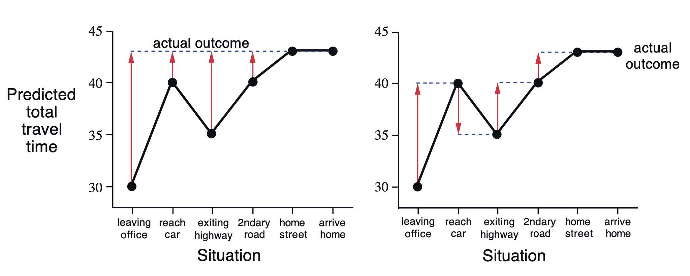
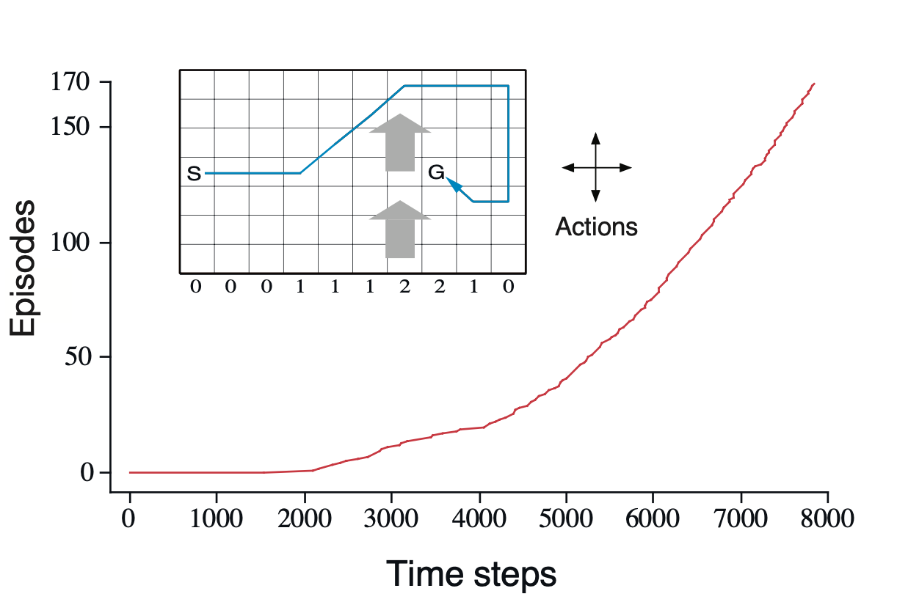
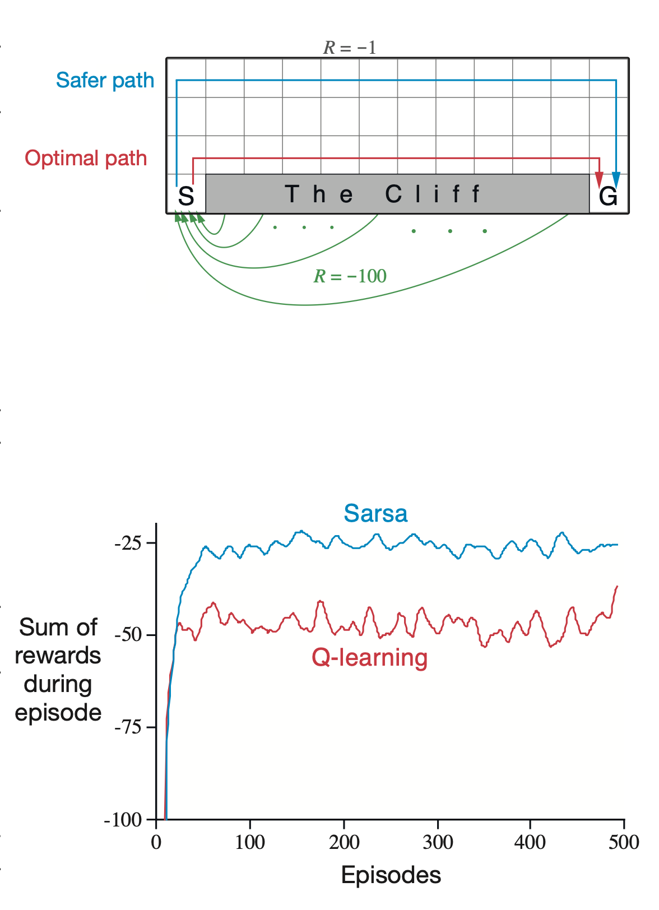

# Temporal-Difference Learning

## Background: Dynamic Programming and Monte Carlo

TD learning is easiest to understand as a mix of two older ideas, **dynamic programming (DP)** and **Monte Carlo (MC)** methods. All three solve the same problem, called **prediction** or **policy evaluation**: given a policy $\pi$, estimate its value function $v_\pi(s)$.

### Dynamic programming: use the model, look one step ahead

DP assumes we **know the model** $p(s', r \mid s, a)$ of the environment. It turns the [Bellman equation for $v_\pi$](finite_markov_decision_processes.md#policies-and-value-functions) into an update rule: start from any guess $V(s)$, and repeatedly replace each state's value with the right-hand side of the Bellman equation,

$$
V(s) \leftarrow \sum_a \pi(a \mid s) \sum_{s', r} p(s', r \mid s, a) \Big[ r + \gamma \, V(s') \Big].
$$

Repeating this for every state, over and over, makes $V$ converge to $v_\pi$. Two features of this update matter for TD:

- **It averages over every possible next step**, using the known probabilities. This is called an *expected update*.
- **It updates a guess partly from other guesses:** the new $V(s)$ combines the reward $r$ for moving from $s$ to $s'$, which is known exactly from the model, with the current *estimate* $V(s')$ of the next state's value, which may still be wrong. Using an estimate of the next state's value, instead of the true value, is called **bootstrapping**.

### Monte Carlo: no model, learn from complete episodes

MC methods need **no model**. They learn from experience: run an episode with policy $\pi$, wait until it ends, and then compute the actual return $G_t$ that followed each visited state. Since $v_\pi(s)$ is the *expected* return from $s$, averaging many observed returns from $s$ estimates it. Done incrementally, as in the [bandit chapter](multi_armed_bandits.md#incremental-implementation), this is

$$
V(S_t) \leftarrow V(S_t) + \alpha \Big[ G_t - V(S_t) \Big].
$$

- **It uses one actual sample**, not an average over all possibilities. This is called a *sample update*.
- **It does not bootstrap:** the target $G_t$ is a real return, so it must **wait until the episode ends** before $G_t$ is known.

**Example:** Take a tiny episodic task with two states, $A$ and $B$. Every episode goes $A \to B \to A \to A \to \text{end}$, so the agent is in $A$ at time $t = 0$, in $B$ at $t = 1$, and in $A$ again at $t = 2$ and $t = 3$. It receives four rewards, $R_1, R_2, R_3, R_4$, where $R_{t+1}$ is the reward for leaving the state at time $t$. We use $\gamma = 1$, so each return is just the sum of the rewards that come after that time step:

$$
G_0 = R_1 + R_2 + R_3 + R_4, \qquad G_1 = R_2 + R_3 + R_4, \qquad G_2 = R_3 + R_4, \qquad G_3 = R_4.
$$

Suppose we observe three episodes:

| Episode | $R_1$ | $R_2$ | $R_3$ | $R_4$ | $G_0$ | $G_1$ | $G_2$ | $G_3$ |
|---|---|---|---|---|---|---|---|---|
| 1 | $1$ | $0$ | $2$ | $1$ | $1 + 0 + 2 + 1 = 4$ | $0 + 2 + 1 = 3$ | $2 + 1 = 3$ | $1$ |
| 2 | $0$ | $4$ | $1$ | $0$ | $0 + 4 + 1 + 0 = 5$ | $4 + 1 + 0 = 5$ | $1 + 0 = 1$ | $0$ |
| 3 | $1$ | $2$ | $0$ | $3$ | $1 + 2 + 0 + 3 = 6$ | $2 + 0 + 3 = 5$ | $0 + 3 = 3$ | $3$ |

State $A$ is visited three times in every episode, at $t = 0$, $2$ and $3$. The usual rule, **first-visit Monte Carlo**, only uses the return following the *first* visit to a state in each episode. So $V(A)$ is estimated from the $G_0$ values, and $V(B)$ from the $G_1$ values:

$$
V(A) = \frac{4 + 5 + 6}{3} = 5, \qquad V(B) = \frac{3 + 5 + 5}{3} \approx 4.33.
$$

The same numbers come out of the incremental update with step size $\alpha = \frac{1}{n}$ (where $n$ counts the episodes so far), starting from $V(A) = V(B) = 0$:

$$
\begin{aligned}
\text{after episode 1:} \quad V(A) &= 0 + \tfrac{1}{1}(4 - 0) = 4, & V(B) &= 0 + \tfrac{1}{1}(3 - 0) = 3, \\
\text{after episode 2:} \quad V(A) &= 4 + \tfrac{1}{2}(5 - 4) = 4.5, & V(B) &= 3 + \tfrac{1}{2}(5 - 3) = 4, \\
\text{after episode 3:} \quad V(A) &= 4.5 + \tfrac{1}{3}(6 - 4.5) = 5, & V(B) &= 4 + \tfrac{1}{3}(5 - 4) \approx 4.33.
\end{aligned}
$$

Notice that $G_0$ includes every reward in the episode, including $R_4$, the last one. So in each episode, Monte Carlo cannot update $V(A)$ until the episode has ended and every reward is known.

An alternative, **every-visit Monte Carlo**, averages the returns after *every* visit to a state. Here it would use $G_0$, $G_2$ and $G_3$ for $A$, nine returns in all, giving $V(A) = \frac{(4 + 3 + 1) + (5 + 1 + 0) + (6 + 3 + 3)}{9} = \frac{26}{9} \approx 2.89$. Both versions converge to $v_\pi(A)$ as the number of episodes grows.

### Where TD learning fits

TD learning takes one idea from each:

- like **MC**, it learns from sampled experience, without a model;
- like **DP**, it bootstraps, so it can update after a single step, without waiting for the episode to end.

DP doesn’t take steps in the environment at all. DP learns from the model, not from experience. It has $p(s', r \mid s, a)$, so it can calculate everything on paper.

MC and TD learn from experience. The agent actually moves through the environment: state, action, reward, next state, and so on. Their updates are tied to that experience.

| | Needs a model $p$? | Bootstraps? | When it can update |
|---|---|---|---|
| Dynamic programming | yes | yes | any time (no experience needed) |
| Monte Carlo | no | no | at the end of the episode |
| TD learning | no | yes | after one step |

## TD Prediction

A simple every-visit Monte Carlo method suitable for nonstationary environments is

$$
V(S_t) \leftarrow V(S_t) + \alpha \Big[ G_t - V(S_t) \Big],
$$

where $G_t$ is the actual return following time $t$, and $\alpha$ is a constant step-size parameter. Let us call this method **constant-$\alpha$ MC**. Whereas Monte Carlo methods must wait until the end of the episode to determine the increment to $V(S_t)$ (only then is $G_t$ known), TD methods need to wait only until the next time step. At time $t + 1$ they immediately form a target and make a useful update using the observed reward $R_{t+1}$ and the estimate $V(S_{t+1})$. The simplest TD method makes the update

$$
V(S_t) \leftarrow V(S_t) + \alpha \Big[ R_{t+1} + \gamma V(S_{t+1}) - V(S_t) \Big]
$$

immediately on transition to $S_{t+1}$ and receiving $R_{t+1}$. In effect, the target for the Monte Carlo update is $G_t$, whereas the target for the TD update is $R_{t+1} + \gamma V(S_{t+1})$:

| Method | Target | Available |
|---|---|---|
| constant-$\alpha$ MC | $G_t = R_{t+1} + \gamma R_{t+2} + \gamma^2 R_{t+3} + \cdots$ | at the end of the episode |
| TD(0) | $R_{t+1} + \gamma V(S_{t+1})$ | after one step |

This TD method is called **TD(0)**, or **one-step TD**, because it is a special case of the TD($\lambda$) and $n$-step TD methods.

The box below specifies TD(0) completely in procedural form.

!!! note "Tabular TD(0) for estimating $v_\pi$"
    **Input:** the policy $\pi$ to be evaluated

    **Algorithm parameter:** step size $\alpha \in (0, 1]$

    **Initialize** $V(s)$, for all $s \in \mathcal{S}^+$, arbitrarily except that $V(\text{terminal}) = 0$

    **Loop for each episode:**

    - Initialize $S$
    - **Loop for each step of episode:**
        - $A \leftarrow$ action given by $\pi$ for $S$
        - Take action $A$, observe $R$, $S'$
        - $V(S) \leftarrow V(S) + \alpha \big[ R + \gamma V(S') - V(S) \big]$
        - $S \leftarrow S'$
    - **until** $S$ is terminal

Because TD(0) bases its update in part on an existing estimate, we say that it is a **bootstrapping** method, like DP.

Finally, note that the quantity in brackets in the TD(0) update is a sort of error. This quantity, called the **TD error**, arises in various forms throughout reinforcement learning:

$$
\delta_t \doteq R_{t+1} + \gamma V(S_{t+1}) - V(S_t).
$$

With this notation, the TD(0) update is simply

$$
V(S_t) \leftarrow V(S_t) + \alpha \, \delta_t.
$$

It has the same shape as the [general update rule](multi_armed_bandits.md#incremental-implementation) from the bandit chapter, $\text{NewEstimate} \leftarrow \text{OldEstimate} + \text{StepSize} \big[ \text{Target} - \text{OldEstimate} \big]$, with target $R_{t+1} + \gamma V(S_{t+1})$, so $\delta_t$ is just "target minus old estimate". If $\delta_t > 0$, the step turned out better than expected and $V(S_t)$ is raised; if $\delta_t < 0$, it turned out worse and $V(S_t)$ is lowered.

### Case Study: Driving Home

Each day as you drive home from work, you try to predict how long it will take to get home. When you leave your office, you note the time, the day of week, the weather, and anything else that might be relevant. Say on this Friday you are leaving at exactly 6 o’clock, and you estimate that it will take 30 minutes to get home. As you reach your car it is 6:05, and you notice it is starting to rain. Traffic is often slower in the rain, so you reestimate that it will take 35 minutes from then, or a total of 40 minutes. Fifteen minutes later you have completed the highway portion of your journey in good time. As you exit onto a secondary road you cut your estimate of total travel time to 35 minutes. Unfortunately, at this point you get stuck behind a slow truck, and the road is too narrow to pass. You end up having to follow the truck until you turn onto the side street where you live at 6:40. Three minutes later you are home. The sequence of states, times, and predictions is thus as follows:
{: #driving-home }

| State | Elapsed time (minutes) | Predicted time to go | Predicted total time |
|---|---|---|---|
| leaving office, Friday at 6 | $0$ | $30$ | $30$ |
| reach car, raining | $5$ | $35$ | $40$ |
| exiting highway | $20$ | $15$ | $35$ |
| secondary road, behind truck | $30$ | $10$ | $40$ |
| entering home street | $40$ | $3$ | $43$ |
| arrive home | $43$ | $0$ | $43$ |

The rewards in this example are the elapsed times on each leg of the journey. We are not discounting ($\gamma = 1$), and thus the return for each state is the actual time to go from that state. The value of each state is the expected time to go. The second column of numbers gives the current estimated value $V(S_t)$ for each state encountered.

A simple way to view the operation of Monte Carlo methods is to plot the predicted total time (the last column) over the sequence, as in the figure below (left). The arrows show the changes in predictions recommended by the constant-$\alpha$ MC method, for $\alpha = 1$. These are exactly the errors between the estimated value (predicted time to go) in each state and the actual return (actual time to go).

Suppose on another day you again estimate when leaving your office that it will take 30 minutes to drive home, but then you become stuck in a massive traffic jam. 25 minutes after leaving the office you are still bumper-to-bumper on the highway. You now estimate that it will take another 25 minutes to get home, for a total of 50 minutes. As you wait in traffic, you already know that your initial estimate of 30 minutes was too optimistic. Must you wait until you get home before increasing your estimate for the initial state? According to the Monte Carlo approach you must, because you don’t yet know the true return.

According to a TD approach, on the other hand, you would learn immediately, shifting your initial estimate from 30 minutes toward 50. In fact, each estimate would be shifted toward the estimate that immediately follows it. Returning to our first day of driving, the figure below (right) shows the changes in the predictions recommended by the TD(0) rule (these are the changes made by the rule if $\alpha = 1$).

The arrows in the two figures are these errors, for the first day of driving:

| State | Predicted time to go $V(S_t)$ | Actual time to go $G_t$ | MC error $G_t - V(S_t)$ | TD error $\delta_t = R_{t+1} + V(S_{t+1}) - V(S_t)$ |
|---|---|---|---|---|
| leaving office | $30$ | $43$ | $43 - 30 = 13$ | $5 + 35 - 30 = 10$ |
| reach car, raining | $35$ | $38$ | $38 - 35 = 3$ | $15 + 15 - 35 = -5$ |
| exiting highway | $15$ | $23$ | $23 - 15 = 8$ | $10 + 10 - 15 = 5$ |
| secondary road, behind truck | $10$ | $13$ | $13 - 10 = 3$ | $10 + 3 - 10 = 3$ |
| entering home street | $3$ | $3$ | $3 - 3 = 0$ | $3 + 0 - 3 = 0$ |

Every MC error is positive, because the trip took longer than each prediction. The TD errors can have either sign, because each one only compares a prediction with the very next one. For example, the TD error at "reach car" is $-5$: by the time you exited the highway, the outlook had improved.

## Sarsa: On-policy TD Control

We now use TD prediction for the **control** problem: not just evaluating a policy, but finding a good one. The first step is to learn an action-value function rather than a state-value function, because with $q_\pi(s, a)$ the agent can choose actions without a model, by picking the action with the largest value.

For an **on-policy** method we must **estimate $q_\pi(s, a)$ for the current behavior policy $\pi$** and for all states $s$ and actions $a$. "On-policy" means the values being learned are those of the very policy the agent is using to act, exploration included. This can be done using essentially the same TD method described above for learning $v_\pi$.

Recall that an episode consists of an alternating sequence of states and state–action pairs:

$$
\cdots \; S_t, A_t \;\xrightarrow{\;R_{t+1}\;}\; S_{t+1}, A_{t+1} \;\xrightarrow{\;R_{t+2}\;}\; S_{t+2}, A_{t+2} \;\xrightarrow{\;R_{t+3}\;}\; \cdots
$$

Before, we considered transitions from state to state and learned the values of states. Now we consider transitions from state–action pair to state–action pair, and learn the values of state–action pairs. Formally these cases are identical: they are both Markov chains with a reward process. The theorems assuring the convergence of state values under TD(0) also apply to the corresponding algorithm for action values:

$$
Q(S_t, A_t) \leftarrow Q(S_t, A_t) + \alpha \Big[ R_{t+1} + \gamma \, Q(S_{t+1}, A_{t+1}) - Q(S_t, A_t) \Big].
$$

This update is done after every transition from a nonterminal state $S_t$. If $S_{t+1}$ is terminal, then $Q(S_{t+1}, A_{t+1})$ is defined as zero. The update uses every element of the quintuple of events $(S_t, A_t, R_{t+1}, S_{t+1}, A_{t+1})$ that make up a transition from one state–action pair to the next, which gives the algorithm its name: **Sarsa**.

Compared with TD(0) for $v_\pi$, the only change is that every $V(\text{state})$ becomes $Q(\text{state}, \text{action})$:

| | TD(0) | Sarsa |
|---|---|---|
| Learns | $V(s) \approx v_\pi(s)$ | $Q(s, a) \approx q_\pi(s, a)$ |
| Target | $R_{t+1} + \gamma V(S_{t+1})$ | $R_{t+1} + \gamma Q(S_{t+1}, A_{t+1})$ |
| Needs before updating | $S_t, R_{t+1}, S_{t+1}$ | $S_t, A_t, R_{t+1}, S_{t+1}, A_{t+1}$ |

It is straightforward to design an on-policy control algorithm based on the Sarsa prediction method. As in all on-policy methods, we continually estimate $q_\pi$ for the behavior policy $\pi$, and at the same time change $\pi$.

!!! note "Sarsa (on-policy TD control)"
    **Algorithm parameters:** step size $\alpha \in (0, 1]$, small $\varepsilon > 0$

    **Initialize** $Q(s, a)$, for all $s \in \mathcal{S}^+$, $a \in \mathcal{A}(s)$, arbitrarily except that $Q(\text{terminal}, \cdot) = 0$

    **Loop for each episode:**

    - Initialize $S$
    - Choose $A$ from $S$ using policy derived from $Q$ (e.g., $\varepsilon$-greedy)
    - **Loop for each step of episode:**
        - Take action $A$, observe $R$, $S'$
        - Choose $A'$ from $S'$ using policy derived from $Q$ (e.g., $\varepsilon$-greedy)
        - $Q(S, A) \leftarrow Q(S, A) + \alpha \big[ R + \gamma \, Q(S', A') - Q(S, A) \big]$
        - $S \leftarrow S'$; $A \leftarrow A'$
    - **until** $S$ is terminal

The policy here is not fixed in advance: it is "$\varepsilon$-greedy with respect to the current $Q$". Every update changes $Q$, so the policy can change from one step to the next, as discussed for [learning online](finite_markov_decision_processes.md#optimality-and-approximation). Evaluation and improvement happen together, one step at a time: each update makes $Q$ a better estimate of the current policy's values, and acting $\varepsilon$-greedily on the new $Q$ shifts the policy toward the actions that now look best.

!!! note "How the policy changes in Sarsa"
    In Sarsa there is no separate policy stored anywhere. The policy is **defined by the current $Q$ table**: "in state $s$, pick the action with the largest $Q(s, a)$ with probability $1 - \varepsilon$, otherwise pick a random action". Each Sarsa update changes $Q$, so the policy changes along with it, automatically, with no separate "improve the policy" step.

    The cycle on every step:

    1. **Act** with the current policy, $\varepsilon$-greedy on the current $Q$.
    2. **Update** one entry of $Q$ using the Sarsa target.
    3. If that changes which action has the largest $Q$ in that state, **the policy in that state has changed**.
    4. The next step acts with the new policy.

    So evaluation (updating $Q$) and improvement (acting greedily on $Q$) are interleaved, one step at a time.

### Case Study: Windy Gridworld 

Shown in the figure below is a standard gridworld, with start and goal states, but with one difference: there is a crosswind running upward through the middle of the grid. The actions are the standard four, $\texttt{up}$, $\texttt{down}$, $\texttt{right}$, and $\texttt{left}$, but in the middle region the resultant next states are shifted upward by a “wind,” the strength of which varies from column to column. The strength of the wind is given below each column, in number of cells shifted upward. For example, if you are one cell to the right of the goal, then the action $\texttt{left}$ takes you to the cell just above the goal. This is an undiscounted episodic task ($\gamma = 1$), with constant rewards of $-1$ until the goal state is reached.

Because every step costs $-1$, the return from any state is minus the number of steps it takes to reach the goal. Maximizing the return therefore means **reaching the goal in as few steps as possible**.

The graph below shows the results of applying $\varepsilon$-greedy Sarsa to this task, with $\varepsilon = 0.1$, $\alpha = 0.5$, and the initial values $Q(s, a) = 0$ for all $s, a$. It plots the number of episodes completed against the total number of time steps. The increasing slope of the graph shows that the goal was reached more quickly over time.

By $8000$ time steps, the greedy policy was long since optimal (a trajectory from it is shown in the figure above); continued $\varepsilon$-greedy exploration kept the average episode length at about $17$ steps, two more than the minimum of $15$.

Note that Monte Carlo methods cannot easily be used here because termination is not guaranteed for all policies. If a policy was ever found that caused the agent to stay in the same state, then the next episode would never end. Online learning methods such as Sarsa do not have this problem because they quickly learn *during* the episode that such policies are poor, and switch to something else.

## Q-learning: Off-policy TD Control

One of the early breakthroughs in reinforcement learning was the development of an **off-policy** TD control algorithm known as **Q-learning** (Watkins, 1989), defined by

$$
Q(S_t, A_t) \leftarrow Q(S_t, A_t) + \alpha \Big[ R_{t+1} + \gamma \max_a Q(S_{t+1}, a) - Q(S_t, A_t) \Big].
$$

The only difference from [Sarsa](#sarsa-on-policy-td-control) is the target:

| | Sarsa (on-policy) | Q-learning (off-policy) |
|---|---|---|
| Target | $R_{t+1} + \gamma \, Q(S_{t+1}, A_{t+1})$ | $R_{t+1} + \gamma \max_a Q(S_{t+1}, a)$ |
| Next action in the target | the action the agent **actually takes** next, $A_{t+1}$ (which may be exploratory) | the **best** action according to $Q$, whether or not the agent takes it |

This target is a sample of the right-hand side of the [Bellman optimality equation for $q_*$](finite_markov_decision_processes.md#optimal-policies-and-optimal-value-functions), $q_*(s, a) = \sum_{s', r} p(s', r \mid s, a) \big[ r + \gamma \max_{a'} q_*(s', a') \big]$: the observed $R_{t+1}$ and $S_{t+1}$ replace the average over $p$, and the current estimate $Q$ replaces $q_*$.

That is what **off-policy** means here: the agent can *behave* one way, e.g. $\varepsilon$-greedy, to keep visiting every state–action pair, while *learning* the values of a different policy, the optimum one. Sarsa, by contrast, learns the values of exactly the policy it follows.

Under this assumption and a variant of the usual stochastic approximation conditions on the sequence of step-size parameters, $Q$ has been shown to **converge with probability $1$ to $q_*$**. The Q-learning algorithm is shown below in procedural form.

!!! note "Q-learning (off-policy TD control) for estimating $\pi \approx \pi_*$"
    **Algorithm parameters:** step size $\alpha \in (0, 1]$, small $\varepsilon > 0$

    **Initialize** $Q(s, a)$, for all $s \in \mathcal{S}^+$, $a \in \mathcal{A}(s)$, arbitrarily except that $Q(\text{terminal}, \cdot) = 0$

    **Loop for each episode:**

    - Initialize $S$
    - **Loop for each step of episode:**
        - Choose $A$ from $S$ using policy derived from $Q$ (e.g., $\varepsilon$-greedy)
        - Take action $A$, observe $R$, $S'$
        - $Q(S, A) \leftarrow Q(S, A) + \alpha \big[ R + \gamma \max_a Q(S', a) - Q(S, A) \big]$
        - $S \leftarrow S'$
    - **until** $S$ is terminal

### Case Study: Cliff Walking 

This gridworld example compares Sarsa and Q-learning, highlighting the difference between on-policy (Sarsa) and off-policy (Q-learning) methods. Consider the gridworld shown below. This is a standard undiscounted ($\gamma = 1$), episodic task, with start and goal states, and the usual actions causing movement $\texttt{up}$, $\texttt{down}$, $\texttt{right}$, and $\texttt{left}$. Reward is $-1$ on all transitions except those into the region marked “The Cliff.” Stepping into this region incurs a reward of $-100$ and sends the agent instantly back to the start.

The graph below shows the performance of the Sarsa and Q-learning methods with $\varepsilon$-greedy action selection, $\varepsilon = 0.1$. After an initial transient, Q-learning learns values for the optimal policy, that which travels right along the edge of the cliff. Unfortunately, this results in its occasionally falling off the cliff because of the $\varepsilon$-greedy action selection. Sarsa, on the other hand, takes the action selection into account and learns the longer but safer path through the upper part of the grid.

!!! note "Why does Q-learning learn the better policy but earn less reward?"
    **Why Q-learning learns the better policy but scores worse:** Q-learning is off-policy. Its $Q$ describes a *perfect greedy* agent. Once learned, with exploration turned off, it would walk the edge to the goal in the minimum number of steps. But during training it doesn't act greedily; it acts $\varepsilon$-greedily, *along the edge*. Every so often a random $\texttt{down}$ sends it into the cliff, and that $-100$ wipes out whatever it saved by taking the short path.

    **Why Sarsa learns the worse policy but scores better:** Sarsa is on-policy. Its $Q$ describes *itself*, random steps included, so it knows that walking the edge is dangerous for an agent that sometimes slips. It takes a longer path a few rows up, a few more $-1$ steps per episode, where random steps can't drop it off the cliff. Its episodes are a bit longer but almost never include $-100$.

!!! note "Fixed vs decreasing $\varepsilon$"

    **Case 1: train with a fixed $\varepsilon = 0.1$, then switch exploration off and act greedily.** Only Q-learning is optimal.

    - **Q-learning:** its $Q$ approximates $q_*$, the values of a perfect greedy agent. Acting greedily on it gives the **optimal** edge path, 13 steps. With no more random steps, it never falls.
    - **Sarsa:** its $Q$ approximates the values of the $\varepsilon$-greedy policy it was following. Those values still contain the risk of slipping off the edge, so greedy on *its* $Q$ still prefers the **safe, longer path**. Switching exploration off afterwards doesn't change what it learned. It is now taking a detour to avoid a danger that no longer exists, so it isn't optimal.

    | Trained with fixed $\varepsilon$, then act greedily | Path | Optimal? |
    |---|---|---|
    | Q-learning | edge path (13 steps) | yes |
    | Sarsa | safer path (longer) | no |

    **Case 2: reduce $\varepsilon$ gradually toward $0$ during training.** Both are optimal. As $\varepsilon$ shrinks, Sarsa's policy gets closer to greedy. Its $Q$ is the value of its own policy, so it gradually stops pricing in the risk. In the limit its $Q$ converges to $q_*$, and its greedy policy becomes the edge path, just like Q-learning's.

!!! note "Why not train with $\varepsilon = 0$?"
    With $\varepsilon = 0$ the agent may never discover the best actions in the first place. Exploration is how it finds out what is good; you reduce it once it has found out.

    **What goes wrong with $\varepsilon = 0$:** A purely greedy agent always picks the action that *currently* looks best. Actions that look bad early on are never tried again, so their estimates are never corrected, even if they are actually the best. It is the same problem as in the [Greedy Play exercise](introduction.md#exercises).