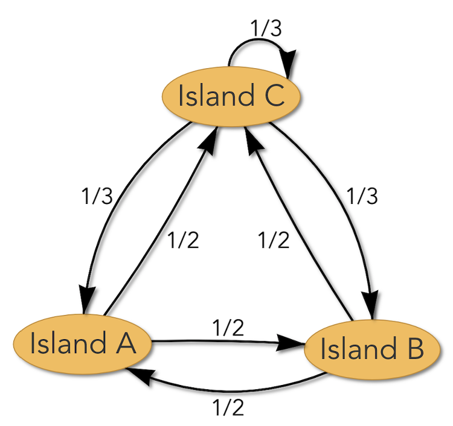
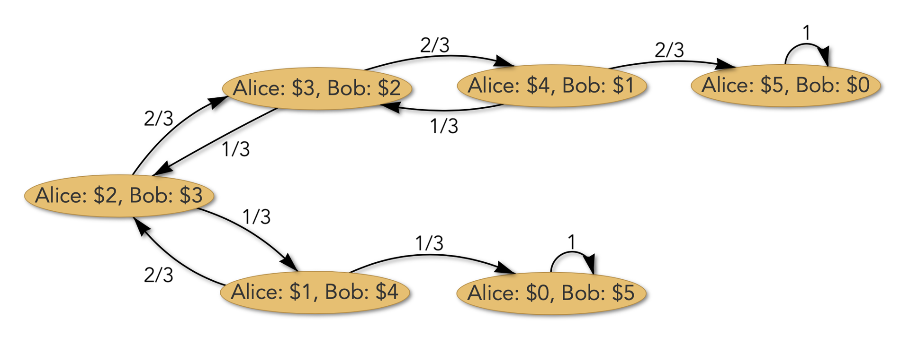

# Applications of matrix algebra- population dynamics and gambling

## Bird migration

Imagine there are three islands inhabited by birds. An ornithologist studying the birds observes the following migration pattern:

- All the birds on island $A$ migrate to another island each year. One half migrates to island $B$, the other half migrates to island $C$.
- Similarly, all the birds on island $B$ migrate to another island each year. One half migrates to island $A$, and the other half migrates to island $C$.
- Finally, one-third of the birds on island $C$ stay in place each year, one third migrate to island $A$, and one third migrate to island $B$.

Initially, there are $10000$ birds on each island. What happens after $20$ years (assuming no births or deaths)?

Denote the number of birds on islands $A$, $B$, $C$ after $k$ years as $A_k$, $B_k$, $C_k$ respectively (so $A_0$, $B_0$, $C_0$ are all equal to $10000$, corresponding to the initial population of $10000$ birds on each island). Translating the above text into equations, it says that the populations after $k+1$ years are given as follows:

$$
\begin{aligned}
A_{k+1} &= \tfrac{1}{2}B_k + \tfrac{1}{3}C_k, \\[0.35em]
B_{k+1} &= \tfrac{1}{2}A_k + \tfrac{1}{3}C_k, \\[0.35em]
C_{k+1} &= \tfrac{1}{2}A_k + \tfrac{1}{2}B_k + \tfrac{1}{3}C_k.
\end{aligned}
$$

We can express this system of $3$ equations in terms of a matrix-vector product:

$$
\begin{pmatrix} A_{k+1} \\[0.35em] B_{k+1} \\[0.35em] C_{k+1} \end{pmatrix}
=
\begin{pmatrix}
0 & 1/2 & 1/3 \\[0.35em]
1/2 & 0 & 1/3 \\[0.35em]
1/2 & 1/2 & 1/3
\end{pmatrix}
\begin{pmatrix} A_k \\[0.35em] B_k \\[0.35em] C_k \end{pmatrix}.
$$

Let us call the $3 \times 3$ matrix here $M$, and write $\mathbf{n}_k$ to denote $\begin{pmatrix} A_k \\ B_k \\ C_k \end{pmatrix}$ (e.g., the initial $3$-vector $\mathbf{n}_0$ has all entries equal to $10000$), so the displayed equation says

$$\mathbf{n}_{k+1} = M\mathbf{n}_k \qquad \text{for } k = 0, 1, 2, 3, \ldots$$

The entries in each column of $M$ are non-negative and sum to $1$; any square matrix with such properties is called a **Markov matrix** (see also [Markov chains](../probability/markov_chains.md)).

Now matrix multiplication enters: feeding the relation "$\mathbf{n}_{k+1} = M\mathbf{n}_k$" into itself repeatedly yields

$$
\mathbf{n}_{20} = M\mathbf{n}_{19} = M(M\mathbf{n}_{18}) = M^2\mathbf{n}_{18} = M^2(M\mathbf{n}_{17}) = M^3\mathbf{n}_{17} = \cdots = M^{20}\mathbf{n}_0 = M^{20}\begin{pmatrix} 10000 \\[0.35em] 10000 \\[0.35em] 10000 \end{pmatrix}.
$$

Fortunately, a computer can rapidly compute $M^{20}$.

Your computer says

$$
M^{20} \approx
\begin{pmatrix}
0.286 & 0.286 & 0.286 \\[0.35em]
0.286 & 0.286 & 0.286 \\[0.35em]
0.429 & 0.429 & 0.429
\end{pmatrix},
$$

and so

$$
M^{20}\begin{pmatrix} 10000 \\[0.35em] 10000 \\[0.35em] 10000 \end{pmatrix}
\approx
\begin{pmatrix} 8570 \\[0.35em] 8570 \\[0.35em] 12860 \end{pmatrix}.
$$

Hence, there are approximately $8600$ birds on each of islands $A$ and $B$ after $20$ years. Raising a matrix to a power has modeled a chain of events feeding into itself, repeating the same behavior over and over.

!!! note
    The columns of $M^{20}$ are all the same (to the accuracy shown)! More amazingly, for all Markov matrices $M$ with positive entries as well as certain Markov matrices (such as $M$ above) with some entries equal to $0$, the powers $M^r$ for all sufficiently big $r$ have all columns essentially equal to a single vector $\mathbf{v}_M$ that is independent of $r$.

    In the above bird example, for all $r \geq 20$ it turns out that $M^r \approx M^{20}$ to high accuracy. Thus, the populations on each island stabilize after not so many years have passed: individual birds keep moving around, but eventually the total population on each island remains the same in all subsequent years.

    The equality of all columns has a remarkable consequence: the proportion of the total population that winds up on each island in the final "steady state" is always the corresponding entry in the common column vector (e.g., $42.9\%$ on island $C$), so it is independent of the way the $30000$ birds were initially distributed across the three islands!

    To see this in action, suppose that instead of spreading the birds evenly we had put **all** $30000$ of them on island $A$, so that $\mathbf{n}_0 = (30000,\ 0,\ 0)$. Then

    $$
    M^{20}\begin{pmatrix} 30000 \\[0.35em] 0 \\[0.35em] 0 \end{pmatrix}
    \approx
    \begin{pmatrix}
    0.286 & 0.286 & 0.286 \\[0.35em]
    0.286 & 0.286 & 0.286 \\[0.35em]
    0.429 & 0.429 & 0.429
    \end{pmatrix}
    \begin{pmatrix} 30000 \\[0.35em] 0 \\[0.35em] 0 \end{pmatrix}
    \approx
    \begin{pmatrix} 8570 \\[0.35em] 8570 \\[0.35em] 12860 \end{pmatrix},
    $$

    the very same steady state as before. The reason is visible once we recall that a matrix-vector product is a linear combination of the columns, with the entries of the vector as coefficients:

    $$M^{20}\mathbf{n}_0 = A_0 \cdot (\text{column } 1) + B_0 \cdot (\text{column } 2) + C_0 \cdot (\text{column } 3) \approx (A_0 + B_0 + C_0)\,\mathbf{v}_M ,$$

    since all three columns are the same vector $\mathbf{v}_M$. Only the **total** $A_0 + B_0 + C_0 = 30000$ survives; how that total was split among the islands is forgotten entirely. The explanation rests on a result that underlies both Google’s PageRank algorithm and the technique called “Markov Chain Monte Carlo” that is used everywhere for efficient sampling of probabilistic scenarios.

**The lesson from this is: matrix powers encode useful (and sometimes rather surprising!) information about chains of events.**

!!! note
    Consider $M = \begin{pmatrix} 0 & 1 \\ 1 & 0 \end{pmatrix}$. In this case we have $M^2 = I_2$, so

    $$
    M^3 = MM^2 = MI_2 = M, \qquad
    M^4 = MM^3 = MM = M^2 = I_2, \qquad
    M^5 = MM^4 = MI_2 = M,
    $$

    and so on: the powers of $M$ alternate between $M$ and $I_2$, with $M^{\text{odd}} = M$ and $M^{\text{even}} = I_2$. So in this case there is no stabilizing behavior for $M^r$ as $r$ grows!

## Gambler’s ruin and genetic evolution

Alice with $\$2$ in her pocket and Bob with $\$3$ in his pocket play a game whose rules go as follows. They flip a biased coin which has $1/3$ chance to be heads and $2/3$ chance to be tails. If it comes up heads, Alice gives Bob a dollar; if it comes up tails, Bob gives Alice a dollar. Eventually one of them runs out of money, at which point the game ends.

What happens after the first turn? There is a $1/3$ chance that Alice will end up with $\$1$, and a $2/3$ chance that Alice will end up with $\$3$. Since Alice has not yet reached $\$5$ (so Bob still has some money) nor $\$0$ (so Alice still has some money), the game goes on for at least one more turn.

What are the odds of various possibilities for what may happen after two turns? Or more turns? This is complicated, since the outcome at each turn depends on the previous turn, which itself is a probabilistic situation. Matrix algebra is the right tool to analyze the long-term question: what are the odds that eventually Alice reaches $\$5$ (i.e., she wins), or the odds that eventually Alice reaches $\$0$ ("gambler's ruin")?

To model the game, we shall keep track of the probability, or chance, that Alice has a given amount of money. We turn it into a vector, keeping in mind that the total number of dollars in play is always $\$2 + \$3 = \$5$, so Alice cannot ever have more than $\$5$:

$$
\mathbf{p} = \begin{pmatrix}
\text{probability that Alice has } \$0 \\
\text{probability that Alice has } \$1 \\
\text{probability that Alice has } \$2 \\
\text{probability that Alice has } \$3 \\
\text{probability that Alice has } \$4 \\
\text{probability that Alice has } \$5
\end{pmatrix} \in \mathbf{R}^6 .
$$

Since it matters how many turns have been played, $\mathbf{p}$ is really a function $\mathbf{p}(n)$ of the number $n$ of turns. Thus, for example, what we have said about the odds for the outcomes after the first turn amounts to saying

$$
\mathbf{p}(1) = \begin{pmatrix} 0 \\ 1/3 \\ 0 \\ 2/3 \\ 0 \\ 0 \end{pmatrix} ,
$$

and it is convenient to make the definition

$$
\mathbf{p}(0) = \begin{pmatrix} 0 \\ 0 \\ 1 \\ 0 \\ 0 \\ 0 \end{pmatrix}
$$

since Alice definitely has $\$2$ when the game starts (the "zero" turn).

After $n$ turns we have

$$
\mathbf{p}(n) = \begin{pmatrix} p_0(n) \\ p_1(n) \\ p_2(n) \\ p_3(n) \\ p_4(n) \\ p_5(n) \end{pmatrix}
$$

for some probabilities $p_i(n)$ that we do not (yet) know.

What happens in the next turn? For example, how likely is Alice to have $\$3$ at the end of the $(n+1)$th turn, with $n \ge 1$? There are two ways this could happen:

- Alice had $\$2$ right after her $n$th turn, and then the coin came up tails. Chance: $p_2(n) \times \frac{2}{3}$.
- Alice had $\$4$ right after her $n$th turn, and then the coin came up heads. Chance: $p_4(n) \times \frac{1}{3}$.

In summary, the chance that Alice has $\$3$ right after her $(n+1)$th turn is $2p_2(n)/3 + p_4(n)/3$. In symbols:

$$
p_3(n+1) = \tfrac{2}{3} p_2(n) + \tfrac{1}{3} p_4(n) \quad \text{for all } n \ge 0 .
$$

Likewise, for Alice to have $\$0$ right after the $(n+1)$th turn, with $n \ge 1$, the two possibilities leading to this are:

- Alice had $\$0$ right after her $n$th turn, and so stays in that "gambler's ruin" state forever. Chance: $p_0(n) \times 1 = p_0(n)$.
- Alice had $\$1$ right after her $n$th turn, and then the coin came up heads. Chance: $p_1(n) \times \frac{1}{3}$.

Thus, $p_0(n+1) = p_0(n) + p_1(n)/3$ for all $n \ge 0$.

If you go through such reasoning for the other possible outcomes right after a given turn, and express the answer in matrix notation, you will find:

$$
\mathbf{p}(n+1) = \underbrace{\begin{pmatrix}
1 & 1/3 & 0 & 0 & 0 & 0 \\
0 & 0 & 1/3 & 0 & 0 & 0 \\
0 & 2/3 & 0 & 1/3 & 0 & 0 \\
0 & 0 & 2/3 & 0 & 1/3 & 0 \\
0 & 0 & 0 & 2/3 & 0 & 0 \\
0 & 0 & 0 & 0 & 2/3 & 1
\end{pmatrix}}_{M} \mathbf{p}(n) = M\mathbf{p}(n)
$$

for all $n \ge 0$. The entries in each column of $M$ are non-negative and sum to $1$: another Markov matrix!

In contrast with the bird migration example, for which high powers of the Markov matrix converge toward a matrix with all columns equal, in this example the high powers $M^n$ do converge toward a limiting matrix but without all columns equal:

$$
M^n \to \begin{pmatrix}
1 & 0.4839 & 0.2258 & 0.0968 & 0.0323 & 0 \\
0 & 0 & 0 & 0 & 0 & 0 \\
0 & 0 & 0 & 0 & 0 & 0 \\
0 & 0 & 0 & 0 & 0 & 0 \\
0 & 0 & 0 & 0 & 0 & 0 \\
0 & 0.5161 & 0.7742 & 0.9032 & 0.9677 & 1
\end{pmatrix}
\qquad \text{as } n \to \infty
$$

(the matrix entries are approximations to 4 decimal digits). The powers $M^n$ become close to this limit already for $n = 30$.

More concretely,

$$
\mathbf{p}(100) = M^{100}\mathbf{p}(0) \approx \begin{pmatrix}
1 & 0.4839 & 0.2258 & 0.0968 & 0.0323 & 0 \\
0 & 0 & 0 & 0 & 0 & 0 \\
0 & 0 & 0 & 0 & 0 & 0 \\
0 & 0 & 0 & 0 & 0 & 0 \\
0 & 0 & 0 & 0 & 0 & 0 \\
0 & 0.5161 & 0.7742 & 0.9032 & 0.9677 & 1
\end{pmatrix}
\begin{pmatrix} 0 \\ 0 \\ 1 \\ 0 \\ 0 \\ 0 \end{pmatrix}
\approx \begin{pmatrix} 0.2258 \\ 0 \\ 0 \\ 0 \\ 0 \\ 0.7742 \end{pmatrix} .
$$

This calculation means that after very many turns, there is a chance of around $22.58\%$ that Alice has $\$0$ (i.e., loses) and a chance of around $77.42\%$ that Alice has $\$5$ (i.e., wins).

**Example:** Suppose we want to compute the probability that the game ends before the 10th turn. How would we do this?

Recall that if at any stage Alice reaches $\$0$ or $\$5$ then she remains in that state forever. Thus, the game ends before the 10th turn precisely when Alice is in the state of $\$0$ or $\$5$ after the 9th turn.

Hence, this probability is $p_0(9) + p_5(9)$. In other words, we compute

$$
\mathbf{p}(9) = M^9 \begin{pmatrix} 0 \\ 0 \\ 1 \\ 0 \\ 0 \\ 0 \end{pmatrix}
\approx \begin{pmatrix} 0.204 \\ 0.028 \\ 0 \\ 0.089 \\ 0 \\ 0.679 \end{pmatrix} ,
$$

so $p_0(9) + p_5(9) \approx 0.204 + 0.679 = 0.883$ (where again we do the computation on a computer). So the chance is approximately $88.3\%$.

!!! note

    The mathematics of the situation we are considering is identical to that which arises in an entirely different context: understanding the effects of mutations over many generations via the Wright–Fisher model for genetic drift. Roughly speaking, here is the dictionary relating the gambling setup with the population dynamics setup: the total amount of money in the gambling setting is replaced with a fixed population size, flipping a coin is replaced with the passage of a specified genetic trait from each generation to the next, the probabilities $1/3$ for heads and $2/3$ for tails are replaced with probabilities $p$ and $1-p$ that an offspring inherits a certain genetic trait or not, and Alice's odds of eventually winning are replaced with the proportion of the population in the long run that has the genetic trait of interest.

    We won't say more about the biological application here, but up to appropriate changes in terminology it is analyzed mathematically by exactly the same procedure that is used below.

    Of course, in the biological context one can seek a more robust framework that analyzes several genetic traits at once (this has no analogue in the win-lose gambling context). The mathematical model of Wright–Fisher can be generalized to accommodate this, and it is the focus of a lot of research in biology.
